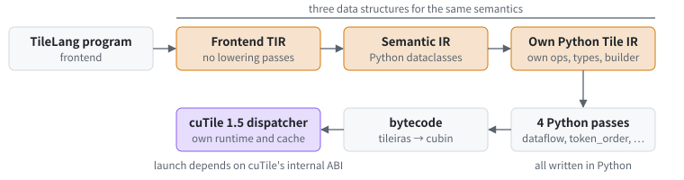
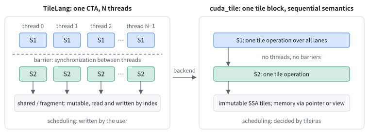
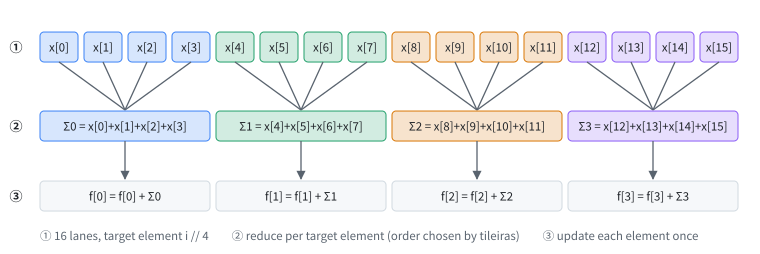
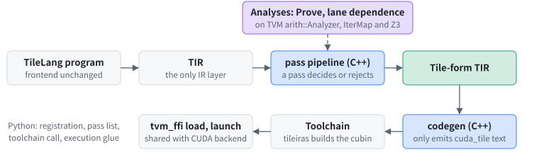

# RFC: Boundaries and Design of the CUDA Tile IR Backend

> A Chinese version of this document is at [`rfc.zh.md`](rfc.zh.md).

<!-- toc -->
## Contents

- [Motivation](#motivation)
- [Background](#background)
- [1. Review comments on the old implementation, and our response](#1-review-comments-on-the-old-implementation-and-our-response)
- [2. Mapping the execution model](#2-mapping-the-execution-model)
- [3. Converting the memory hierarchy](#3-converting-the-memory-hierarchy)
- [4. Rebuilding synchronization and reduction](#4-rebuilding-synchronization-and-reduction)
- [5. Converting built-in functions](#5-converting-built-in-functions)
- [6. Aligning compiler behavior](#6-aligning-compiler-behavior)
- [7. Compilation stack](#7-compilation-stack)
- [8. Verification and maintenance](#8-verification-and-maintenance)
  - [8.1 Verification and acceptance](#81-verification-and-acceptance)
  - [8.2 Maintenance](#82-maintenance)
- [9. Merge plan](#9-merge-plan)
  - [9.1 Principles of the split](#91-principles-of-the-split)
  - [9.2 Sequence of pull requests](#92-sequence-of-pull-requests)
- [10. Open questions](#10-open-questions)

<!-- /toc -->

## Motivation

Our goal is to add a CUDA Tile IR backend to TileLang (CUDA Tile IR is called Tile IR below): CUDA Tile IR is generated from a TileLang program, and tileiras compiles and schedules it. This backend converts only the semantics that Tile IR can express correctly; for semantics it cannot convert, it reports a compile error and rejects the program. This backend does not aim to be perfectly compatible with all the semantics of the CUDA backend; instead, we hope that Tile IR can improve performance in some scenarios. tileiras decides layout, pipelining, warp specialization and instruction selection on its own, and optimizes for each hardware generation. This gives developers a chance to get fairly good performance through autotuning alone, without changing the kernel and without implementing complex, architecture-specific scheduling logic by hand in the front end, while staying compatible across hardware.

## Background

We submitted a PR for this earlier, and several problems were pointed out in it. We went back over them and agree, so we redesigned the backend. Before submitting the formal PR, we would like to submit an RFC for the community to review.

To make the review easier, we start from the review comments on [tile-ai/tilelang#3247](https://github.com/tile-ai/tilelang/pull/3247) and use them to introduce our solution and design.

## 1. Review comments on the old implementation, and our response

The pipeline of the Tile IR backend submitted earlier (called "the first version" below) is as follows:



The comments from the community and the maintainers focus mainly on the following points:

- **1. Too many try-catch blocks, and case-by-case lowering:** The code has too many try-catch blocks, and thread-level code is handled by recognizing, one by one, the forms seen before. The lowering mostly matches existing DSL forms and adds a separate handler for each of them, so it may be "overfitted" and may not work well in real scenarios.
- **2. A second set of IRs was built:** In addition to TIR, the first version built a Semantic IR and a Tile IR implemented in Python, together with the corresponding lowering flow. The same semantics were maintained once in each of three sets of data structures, and every feature added to TileLang required changes in all three layers.
- **3. Passes written in Python:** About 18.5k lines of Python; a rewrite in C++ was suggested.
- **4. The standard integration guide for new backends was not followed:** The backend was not integrated as the repository's guide requires.
- **5. Hard to review:** The single submission was too large to review easily.

On problem 1: we think a defect in the **programming model** of the previous version is the main cause. There was no uniform set of rules for how thread code corresponds to tile operations, so new patches were added again and again whenever an unexpected combination of semantics appeared. So we first describe the programming model: in turn, the mapping of the execution model (chapter 2), the conversion of the memory hierarchy (chapter 3), the rebuilding of synchronization and reduction (chapter 4), the conversion of built-in functions (chapter 5), and the alignment of compiler behavior, that is, the currently known places where it may be inconsistent with the CUDA backend (chapter 6).

On problems 2–4: all transformation and lowering is done in TIR passes, rewritten in C++, and Tile IR is produced only in the codegen stage. This may involve adding some attributes. Chapter 7 describes the compilation stack and how the backend is integrated as a new backend.

On the code being too large to review: chapter 9 discusses the plan for splitting it into PRs, and there we confirm with the maintainers what they want as acceptance criteria, together with the other open questions.

---

## 2. Mapping the execution model

The most visible difference between the programming models of TileLang and CUDA Tile IR is this: besides ops that act directly at the tile level (such as `T.gemm` and `T.copy`), TileLang can also operate at the element level inside a tile, in two forms: thread code that uses the thread index explicitly, and `T.Parallel` loops. Tile-level ops fit the semantics of Tile IR naturally. Element-level code has no direct counterpart in Tile IR, because Tile IR does not expose threads.



To close this gap, we draw on two kinds of existing approaches: converting GPU programs into loops on the CPU ([MCUDA](https://doi.org/10.1007/978-3-540-89740-8_2), [POCL](https://doi.org/10.1007/s10766-014-0320-y), [Polygeist](https://doi.org/10.1145/3572848.3577475)), and vectorizing SPMD programs ([ISPC](https://doi.org/10.1109/InPar.2012.6339601), [whole-function vectorization](https://doi.org/10.1109/CGO.2011.5764682)). The idea is to treat Tile IR as a single-threaded executor with many lanes, and to convert the concurrent operations of several threads into vector operations on whole tiles.

**Treat a tile as a very wide SIMD vector.** The data of thread t in the source program (or of the t-th iteration of a `T.Parallel`) is placed at position t of the tile, and this position is called **lane** t. A lane is only a position in the data; how many threads are actually used at run time is decided by tileiras and does not depend on the number of lanes. Under this analogy, every concept in thread code has a vector counterpart:

| Thread code | Tile IR | Counterpart in SIMD |
|---|---|---|
| n threads (or the n iterations of a `T.Parallel`) | One dimension of a tile, whose length is n rounded up to a power of two | The width of the vector |
| The thread index `tx` (or the loop variable `i`) | A tile whose content is 0, 1, 2, … (`iota`) | A vector whose content is 0, 1, 2, … |
| A value that differs from thread to thread | A tile with one element per lane | A vector register |
| A value that is the same in every thread | A scalar (a 0-dimensional tile) | A scalar register |
| A statement that runs on only some of the threads | A masked tile operation; the mask is a boolean tile | A vector instruction with a predicate register (such as the masks of AVX-512 and SVE) |

**Thread code is equivalent to a parallel loop.** "Every thread runs this code once" can be written as a `T.Parallel` loop over all threads: the iterations are independent of each other and can run in parallel. This equivalence has two conditions: the program has no data race, and there is no dependence between lanes. When the conditions hold, loop fission can also be applied to this loop at statement boundaries, splitting it into several loops that run one after another, and the result does not change.

**Conversion steps.** With the two points above, the conversion has three steps. The same source program is used through all three steps below (`x` and `y` are shared buffers of 128 elements, and each thread accesses its own element with `tx`; `A_s`, `B_s` and `C_f` are shared and fragment buffers defined elsewhere):

```python
tx = T.get_thread_binding()
x[tx] = A[bx, tx] * 2.0         # S1: thread code
y[tx] = x[tx] + 1.0             # S2: thread code
T.gemm(A_s, B_s, C_f)           # tile op
B[bx, tx] = y[tx]               # S3: thread code
```

1. **Thread code is rewritten into loops (pass `ThreadToParallel`).** Tile-level ops are left unchanged. For statements that depend on the thread, a contiguous piece of code is rewritten as a whole into one `T.Parallel` over all threads, and the thread index is replaced by the loop variable. The piece ends at a tile op or a barrier, and the thread code after it starts a new loop. After this step the program contains only tile ops and `T.Parallel`, and thread code follows the same rules as a `T.Parallel` the user wrote.

   After the rewrite, S1 and S2 are in the same loop, and `T.gemm` separates them from S3:

   ```python
   for t in T.Parallel(128):
       x[t] = A[bx, t] * 2.0       # S1
       y[t] = x[t] + 1.0           # S2
   T.gemm(A_s, B_s, C_f)           # the tile op stays outside the loops, unchanged
   for t in T.Parallel(128):
       B[bx, t] = y[t]             # S3
   ```

2. **Loop fission at the boundaries of source statements (codegen).** The for loop is split here to model barriers and to fit the semantics of Tile IR. A Tile IR op works on a whole tile: the next op always receives the result of the previous op computed on all lanes, as if the ops seen in Tile IR had a barrier between them by nature. Note that real barrier code is not necessarily generated at run time, and this does not mean that at run time all threads finish one op before they start the next: the order in the IR only expresses the dependences between statements, and the tileiras backend rebuilds the thread behavior from it.

   After the split, the meaning is the same as:

   ```python
   for t in T.Parallel(128):
       x[t] = A[bx, t] * 2.0       # S1 is done on all 128 lanes
                                   # loop fission
   for t in T.Parallel(128):
       y[t] = x[t] + 1.0           # then S2 is done on all 128 lanes
   T.gemm(A_s, B_s, C_f)
   for t in T.Parallel(128):
       B[bx, t] = y[t]             # S3
   ```

3. **Each loop is vectorized (codegen).** The loop variable becomes an `iota`, and every operation in a statement generates one op that acts on a whole tile.

   The generated Tile IR (a sketch). `x` and `y` each become a tile value; "S2 runs after S1 is done" shows up as `%y` using `%x`; `T.gemm` corresponds directly to one `mmaf`:

   ```text
   %v  = load_view_tko %A_view[%bx, 0]       // S1: read the 128 elements of row bx of A at once
   %x  = mulf %v, 2.0                        //     multiply by 2, element by element, on 128 lanes
   %y  = addf %x, 1.0                        // S2: uses %x, so it comes after S1
   %c1 = mmaf %as, %bs, %c0                 // T.gemm
   store_view_tko %y, %B_view[%bx, 0]       // S3: write back 128 elements at once
   ```

The resulting execution order is: one statement finishes on all lanes before the next statement starts. We call this **lock-step execution**.

**Divergent control flow.** Different threads may take different branches, or loop a different number of times. After vectorization the code runs only once, in order, so if-conversion is applied as in SIMD: control flow is turned into data flow, and a mask records on which lanes each statement takes effect. A pass marks the divergent branches, and codegen generates both branches:

  ```python
  if tx < 5:
      y[tx] = x[tx] + 1
  else:
      y[tx] = x[tx] - 1
  ```

  ```text
  %t  = iota : tile<128xi32>           // lane numbers 0–127
  %m  = cmpi slt %t, 5                 // the condition becomes a mask: one truth value per lane
  %y1 = addi %x, 1                     // the then branch, computed on all lanes
  %y2 = subi %x, 1                     // the else branch, computed on all lanes
  %y  = select %m, %y1, %y2            // each lane takes its own side according to the mask
  ```

  Pure computation is done on both sides and then selected with `select`; stores and atomics carry the mask; operands that may fault (reading memory through a pointer, division by a divisor that is not a constant) are evaluated only inside the mask. A divergent loop is handled in the same way: the loop continues as long as some lane has not exited, and the lanes that have exited no longer take effect.

**Why the semantics are the same before and after the conversion.** Our criterion is: when the program has no data race, the result of the generated Tile IR is a result that the source program already allows under CUDA semantics; a data race is undefined behavior in TileLang in the first place. There are two reasons:

- Lock-step execution is one of the interleavings the source program allows. Interleaving the instructions of the threads, in some order, into one execution sequence is called an interleaving; lock-step execution is the one in which "the threads take turns to finish the same statement", and it respects every barrier.
- The mask reproduces the control flow of each lane exactly: the statements each lane executes, their order and the values it sees are the same as when it runs alone.

This argument depends on three semantic rules of TileLang. We ask upstream to confirm that they match its understanding:

- The iterations of a `T.Parallel` are independent of each other, and which thread an iteration is assigned to is not observable;
- When two threads access the same location between two barriers, and at least one of the accesses is a non-atomic write, it is a data race and the result is undefined;
- Code that does not depend on the thread is executed once by every thread, so an unguarded side effect (such as `atomic_add(c, 1)`) happens "number of threads" times, and the generated code makes it happen the same number of times.

The following cases **cannot** be vectorized safely. We check at compile time whether a program falls into them, and if it does, compilation is rejected with an error.

- **A thread waits for another thread**: producer/consumer warps, an mbarrier that waits for other threads, a barrier in which only some of the threads take part. Under lock-step execution the thread being waited for comes later in the order, so the wait never completes.
- **`T.Parallel` is used under divergent control flow** (such as `if tx < 64: for i in T.Parallel(128)`): the result depends on which thread an iteration is assigned to.

In existing TileLang kernels these two forms often appear in kernels with hand-written warp specialization or other fine-grained scheduling. In these kernels the user specifies the schedule by hand, which goes against the design intent of the Tile IR backend, so rejecting them is a reasonable choice.

## 3. Converting the memory hierarchy

The second difference in the programming model is the memory model. TileLang provides almost all the storage levels of PTX: the on-chip buffer kinds are local, fragment and shared. Tile IR does not expose the on-chip memory levels explicitly: the user sees only global memory and SSA tiles that stand for on-chip data. In addition, a buffer in TileLang can be modified, but a tile value in Tile IR is SSA and immutable.

To reconcile the difference in the memory models, we follow the mapping rules below:

**Conversion and order of memory accesses inside one statement**

Tile IR has only one kind of tile, so the different TileLang buffers are mapped to SSA tile values according to the behavior the TileLang semantics specify:

- `local`: independent between threads. It is enough to add a lane dimension to the tile, so that every thread (lane) keeps its own copy of the tile. For example:

  ```python
  r = T.alloc_local((4,), "float32")      # one copy per thread, 4 elements
  tx = T.get_thread_binding()
  for k in T.serial(4):
      r[k] = A[bx, tx * 4 + k]
  ```

  ```text
  %r : tile<128x4xf32>                    // the extra first dimension is the lane: row t is r[0..3] of thread t
  ```

- `shared`: shared inside the CTA, so it is mapped to one tile with the original dimensions. Thanks to the lock-step execution defined in chapter 2, the accesses of different threads to one shared buffer become one synchronous access to different lanes of one buffer; under divergent control flow, the results of the two sides are taken through the mask and `select`. Undefined behavior, such as a data race, is neither checked nor handled, as in the CUDA backend.
    In terms of how they are handled, accesses to a shared buffer fall into two kinds. The first kind is the regular access: a tile op reads or writes a whole region (such as `T.copy(A[bx, :], a)`), or the index is proven at compile time to have one of two forms: it does not vary with the lane (such as `s[0]`); or each dimension is an affine function `stride * t + offset` of one lane coordinate, where the stride is a power of two and the offset is aligned, and different dimensions use different lane coordinates (such as `a[t]` and `a[t // 4, t % 4]`). The second kind is the irregular access: every other access, and every access for which this cannot be proven (such as `a[idx[t]]` and `a[i + j]`). It typically arises when the address each thread (lane) accesses is a run-time value; it also includes taking an address and atomic updates, which need a real address.

    In the regular case, the operation is done directly on the tile:

    ```python
    a = T.alloc_shared((32, 4), "float32")
    s = T.alloc_shared((1,), "float32")
    for t in T.Parallel(128):
        a[t // 4, t % 4] = x[t] + s[0]
    ```

    ```text
    %s1 = broadcast %s : tile<128xf32>        // s[0]: all lanes read the same element, which is a broadcast
    %y  = addf %x, %s1
    %a  = reshape %y : tile<32x4xf32>         // a[t // 4, t % 4]: 128 lanes arranged as 32 × 4, which is a reshape
    ```

    Writing `a` produces a new tile value, and a later read of `a` uses this value directly; the allocations of `a` and `s` generate no code. The Tile IR above is a sketch, and the way the ops are written is simplified.

    Ideally, the irregular case takes three steps on SSA: first, the elements to be accessed are taken out of the buffer (tile) to form a new tile, which is a gather; second, the desired operation is done on the new tile; third, the result is scattered back to the source positions.

    ```text
    // A sketch: the two ops gather and scatter do not exist in cuda_tile; they only explain what the three steps mean
    // %shm is a shared buffer in the DSL
    %k  = load_view_tko %idx_view[%bx, 0]       // 128 indices, known only at run time
    %g  = gather %shm, %k                       // step 1: take 128 elements out of tile %shm by index, forming a new tile (the op only conveys the meaning; it does not exist in the dialect)
    %r  = mulf %g, 2.0                          // step 2: do the desired operation on the new tile
    %a1 = scatter %shm, %k, %r                  // step 3: write back to the source positions by index, giving the new tile value %a1 (it does not exist either)
    ```

    But in practice CUDA Tile IR does not expose `cuda_tile.gather` and `cuda_tile.scatter` yet; it only has gather_load and scatter_store operations that load and store data in global memory. So here we make a round trip through global memory, which is a known weakness that may cause a performance regression.

    ```python
    a = T.alloc_shared((128,), "float32")
    for i in T.Parallel(128):
        a[i] = A[bx, i] * 2.0
    for i in T.Parallel(128):
        B[bx, i] = a[idx[bx, i]]            # the index comes from run-time data
    ```

    What the generated Tile IR does is shown in pseudocode (written as Tile IR it would be rather long; here `W` is a temporary area in global memory given to this kernel, and each block uses its own part of it):

    ```text
    v = A[bx, 0:128] * 2.0               // the value of a
    W[bx * 128 + i] = v[i]               // stored into global memory
    k = idx[bx, 0:128]                   // 128 indices
    r[i] = W[bx * 128 + k[i]]            // read by address: each lane reads element k[i] of a
    B[bx, 0:128] = r
    ```

- `fragment`: mostly the same as shared; it also uses a tile with the original dimensions. There are two differences:

    1. **When several lanes access the same element, the result is defined.** On shared memory this is a data race, which is undefined behavior, and the backend does not check it. On a fragment, when the layout of the fragment is fixed first, in the CUDA backend these accesses fall on the same thread and take effect in loop order; this backend defines the result as that one (chapter 6): a colliding update must be writable in reduction form, that is `f[element] = f[element] op v`; a colliding store takes the value of the last iteration that writes when that iteration can be determined, and otherwise the written values must be proven equal, or compilation is rejected.
    2. **The thread index cannot be used as an index.** `a[tx]` is legal for shared memory: each thread accesses its own element, which corresponds to lane t accessing element t. What `f[tx]` means for a fragment depends on which elements the layout assigns to this thread, and in this backend the layout is decided by tileiras, so compilation is rejected. A fragment can be accessed only with the loop variable of a `T.Parallel`.

**Conversion and order between different memory access statements**

**The memory access ops of Tile IR:** Tile IR has two interfaces for loading and storing data in global memory: `load/store_tko` and `load_view/store_view_tko`. The view interface is for accesses whose index is an affine function of the lane number, that is, accesses in which a whole block can be described by a base, a shape and a stride; TMA can be used only through the view interface. tko stands for token, which marks the order of memory operations. By default Tile IR may reorder all memory accesses, unless they are ordered explicitly with tokens: if op2 must happen after op1, the token returned by op1 is passed to op2 as an argument.

The mapping rule that follows is: the def chain of the memory operations of the TileLang program is analyzed and connected with tokens, and whether the index is affine is analyzed in order to enable TMA. Dedicated passes decide these two points.

## 4. Rebuilding synchronization and reduction

The result of a TileLang program depends on two kinds of order: the order between threads established by synchronization operations, and the order in which several lanes update the same element inside one statement. Tile IR has no threads, and one op writes all lanes at once, so both kinds of order must be re-established. The former is called rebuilding synchronization, and the latter rebuilding reduction.

**Rebuilding synchronization**

Synchronization in TileLang has two levels. Inside a CTA there are: barriers in which all threads take part (`T.sync_threads()`, and the barriers the CUDA backend inserts automatically); waits for asynchronous copies (`cp.async` plus a wait, TMA plus an mbarrier wait); and forms in which threads wait for each other (an mbarrier that waits for other threads, producer/consumer between warps). Between CTAs there are: atomics, and spinning through global memory.

**A barrier in which all threads take part generates no code.** Such a barrier requires that "all threads finish the code before it, and only then start the code after it". This is already guaranteed by the lock-step execution stated in chapter 2. For example:

```python
tx = T.get_thread_binding()
a[tx] = A[bx, tx] * 2.0
T.sync_threads()                    # all threads finish writing a before the reduction
T.reduce_sum(a, s, dim=0)
```

```text
%v = load_view_tko %A_view[%bx, 0]
%a = mulf %v, 2.0
%s = reduce %a add                  // uses %a, so it comes after the write of a; the barrier has no op
```

**Asynchronous copies become synchronous copies.** `cp.async` plus a wait, and TMA plus an mbarrier wait, are both turned into copies that complete synchronously where they are issued, and the wait itself is deleted. This does not change the result: to tell "the copy is done when it is issued" from "the copy is done at the wait", the program must read the destination of the copy before the wait, and that is itself a data race. Whether the compiled result uses TMA, how it is pipelined, and how the internal asynchronous pipeline is built are all decided by tileiras.

**Synchronization that cannot be rebuilt is rejected at compile time.** When a thread waits for another thread, the thread being waited for comes later in lock-step execution, so the wait never completes (chapter 2). The constructs of this kind are:

- an mbarrier that waits for other threads;
- a named barrier, or a barrier in which only some of the threads take part (such as `if (tid < 32): for i in T.Parallel(64): Barriers`);
- spinning on an on-chip buffer;
- the producer/consumer division of work between warps.

**Synchronization between CTAs corresponds directly.** CTAs interact only through global memory, and TileLang and Tile IR have the same memory model at this level: an ordinary access corresponds to `weak`, and an atomic corresponds to an atomic op of `cuda_tile`. To wait between CTAs, an atomic should be used: the read is written as an atomic read with acquire semantics, and Tile IR guarantees that it reads a value another CTA has already written. Waiting with ordinary reads and writes is undefined behavior; this backend does not check it and does not guarantee the same behavior as the CUDA backend: on Tile IR the example below may pass straight through, or it may hang.

```python
# CTA 0
flag[0] = 1                     # an ordinary write
# CTA 1
while flag[0] == 0:             # an ordinary read, looping to wait for CTA 0
    pass
```

**Rebuilding reduction**

**The problem.** For a colliding update on a fragment, the semantics expressed in TileLang may be that a single thread updates the same element repeatedly over several iterations. Take

```python
for i in T.Parallel(16):
    frag[i // 4] += x[i]
```

as an example: every four iterations update the same element. In the source program these four run one after another, and each reads the value the previous one updated, so all four `x[i]` are added to the element. If the statement is vectorized directly as in chapter 2, it becomes one read, one add and one write on all lanes: every lane reads the value before the update, and when the four lanes write back to the same element, only one can remain. The result is that only one `x[i]` is added to the element, and the other three are lost.

**The approach.** The contributions written to the same element are first reduced to one value, and then each element is updated only once. We call this operation **combine**. It is reduce-by-key in data-parallel programming: the key is the index of the target element, and the values are the contributions of the iterations. [`reduce_by_key`](https://github.com/NVIDIA/cccl/blob/main/thrust/thrust/reduce.h) in Thrust, [`scatter_reduce`](https://docs.pytorch.org/docs/stable/generated/torch.scatter_reduce.html) in PyTorch and array reductions in [OpenMP](https://www.openmp.org/specifications/) are all this operation.



In the example above, the lanes that write to the same element form regular groups (4 per group), so the contributions are reshaped to "number of elements × lanes per group", reduced along the axis inside a group, and then applied to the old value once (a sketch):

```text
%g  = reshape %x : tile<4x4xf32>         // the 16 contributions split into 4 groups by target element, 4 per group
%r  = reduce %g add, dim = 1             // each group is reduced to one value
%f1 = addf %f, %r                        // each element is updated only once
```

**The decision rule.** A statement that reads, modifies and writes back its own buffer is handled in the following order:

1. Different lanes are proven to write different elements (such as `f[i] = f[i] * 2 + x[i]`): there is no collision, and the statement is vectorized directly.
2. It cannot be proven, and the update is in reduction form `f[e] = f[e] op v`: it is rewritten as a combine. `op` can be `+`, `-`, `max`, `min`, `&`, `|` or `^`, and neither `v` nor the enclosing conditions read `f`. Only in this form do "updating one after another" and "reduce first, then update once" give the same result.
3. It cannot be proven, and the update is not in reduction form (such as `f[i // 4] = f[i // 4] * 2 + x[i]`): it is rejected at compile time.

"Proven" means proving at compile time that the map from indices to elements is one-to-one. Failing to prove it does not mean that there really is a collision; in that case step 2 or step 3 applies, and the result is never wrong. Updates of reducers follow the same rule.

**Two known limitations.**

- The accumulating update with an irregular target index (such as `f[idx[t]] += x[t]`): which lanes write to the same element is known only at run time. It is not supported at present and is a compile error.
- A `T.Parallel(n)` whose trip count is known only at run time: it is split into chunks of a fixed width, which run one after another, and the iterations beyond `n` in the last chunk are masked off. Each chunk is reduced internally first, and the chunks accumulate into the same buffer one after another; when `n` is not a multiple of the width, a mask is added.

**Differences from the CUDA backend.** The CUDA backend accumulates one by one; combine reduces first and then updates, and the association order of the reduction is decided by tileiras. A different reduction order may make floating-point results not bit-equivalent. Chapter 6 lists this item and the other known inconsistencies.

## 5. Converting built-in functions

Tile-level ops (`T.copy`, `T.gemm`, `T.reduce`, `T.cumsum`, `T.fill` and so on) have direct counterparts in Tile IR and are translated one by one; for example, `T.gemm` corresponds to `mmaf`. This chapter describes several other kinds of built-in functions: they have no direct counterpart in Tile IR, or the counterpart is used differently, so the backend has to convert them.

**Collective operations inside a warp (warp shuffle, vote, warp reduce).** These operations exchange or aggregate data between threads, and Tile IR has no dedicated op for them. The backend first arranges the n lanes in groups of 32 into the shape `[n/32, 32]`, so that one row is one warp, and then builds the operations from existing ops:

- In a warp shuffle, each lane reads the value of another lane in the same warp, which corresponds to rearranging the elements inside each row;
- A vote and a warp reduce compute the and, or, sum, maximum and so on of the values of all lanes in a warp, which corresponds to computing one result for each row and broadcasting it to every lane of that row.

The width and the source lane of a shuffle must be known at compile time.

**Random numbers (`T.rng_init`, `T.rng_rand*`).** The CUDA backend uses Philox4_32_10 from curand, with one generator per thread. Tile IR has no op for random numbers, so the backend expands Philox4_32_10 into integer operations on one state per lane. The numbers it computes are bit-identical to those of the CUDA backend, which is guaranteed by tests that compare bit for bit with the CUDA backend. It is a compile error when either of two conditions does not hold: the `rng_init` that each draw corresponds to is the same one on all execution paths; and the draw is certain to be evaluated. float32 normally distributed random numbers are not supported.

**PDL (`T.pdl_sync`, `T.pdl_trigger`).** PDL lets two consecutive kernels overlap in execution. Tile IR has corresponding ops, which are translated directly. They are synchronization operations, so they join all the token chains (chapter 3):

```text
T.pdl_trigger()   %j = join_tokens %t3, %u1                 // join all token chains
                  %p = gdc_launch_dependents_tko token = %j
```

**Grid synchronization (`T.sync_grid`).** It requires all CTAs of the grid to reach the synchronization point before any of them continues, and Tile IR has no counterpart. The backend splits the kernel into several kernels at the synchronization point and launches them one after another on the same stream: all CTAs of one kernel finish before the next kernel starts, which is exactly the order that grid synchronization requires. The conditions are that the synchronization point is at the top level of the kernel (not inside a loop or a conditional), and that the content of on-chip buffers does not cross the synchronization point; otherwise it is a compile error.

**Built-in functions with no counterpart** are rejected at compile time: inline assembly, `call_extern` without a defined mapping, explicit `wgmma`/`tcgen05`/`ldmatrix`/`mma`, explicit approximate intrinsics (`T.__log`, `T.__sin` and so on), and the rounding mode and saturation arguments of `T.cast`.

## 6. Aligning compiler behavior

An accepted program should give the same result on this backend and on the CUDA backend. This chapter lists the places currently known where they may differ, in four groups. Any difference other than the ones listed here is a defect of this backend.

**Numerics.** Element-wise `+`, `-`, `*`, `/`, comparisons and type conversions with default rounding agree bit for bit with the CUDA backend under the same floating-point flags. There are three differences:

1. **The association order of reductions.** For `T.reduce` and the combine of chapter 4, the order of the additions is decided by tileiras, and floating-point results may differ in the last few bits.
2. **fma contraction.** `a*b ± c` is contracted into fma as nvcc does. But when the product is used more than once or goes through a fragment, whether nvcc contracts depends on the shape of the code it sees, and the two sides may differ.
3. **`log`, `log2`, `sin`, `cos`, `tan` and `pow` under fast math.** Tile IR cannot request approximate computation for these operations for now, so this backend uses exact operations and the CUDA backend uses approximate instructions. `exp` and `tanh` use approximate computation on both sides.

**Scheduling.** Layout, pipelining, warp roles and instruction selection are all decided by tileiras. Of the scheduling annotations of TileLang, those for which Tile IR has a hint are forwarded (for example, `T.copy(disable_tma=True)` corresponds to `allow_tma = false`), and those for which it has none (for example, `T.use_swizzle`) are dropped with a warning. How the hints of the two sides correspond is question 7 of chapter 10.

**Places where the result of the CUDA backend itself is not deterministic.** For two kinds of programs, the result of the CUDA backend depends on its internal choices, and this backend gives one definite result:

- Several iterations update the same fragment element (such as `f[i // 4] += x[i]`): the result of the CUDA backend depends on layout inference; sometimes it is the accumulation of all contributions, and sometimes each replica is added to only once. The result of this backend is always the accumulation of all contributions (question 6 of chapter 10).
- Programs with data races (the data race on shared memory in chapter 3, and waiting between CTAs with ordinary reads and writes in chapter 4): the two sides may behave differently, and the latter may pass straight through or hang on Tile IR.

## 7. Compilation stack



The passes and codegen are implemented in C++. The Python part contains only registration, the
ordering of the passes, toolchain invocation and execution adaptation. **Tile-form TIR** is the
subset of TIR that codegen accepts: every decision made by the passes is already written in the IR
and has been verified. These decisions include: which representation a buffer uses; whether a global
memory access uses a view or a pointer tile (the two memory access interfaces of Tile IR: the former
reads and writes a whole region, the latter reads and writes element by element by address); which
operands may be evaluated only inside the mask. Our approach is to add a set of `tl.tileir.*`
intrinsics and attributes to record these decisions. Whether upstream agrees with this approach is
question 2 of chapter 10. The work is divided among the parts as follows:

- **pass**: One pass is responsible for only one kind of decision or one class of rejection. It does
  the analysis it needs by itself. Its proof obligations (a proof obligation is a condition that must be
  proven to hold before an approach is used) all go to `Prove`, which is the only entry point
  for proofs. Then it writes the decision into the IR. It only adds decisions. It does
  not overturn the decisions of earlier passes, does not cover for other passes, and does not select
  by kernel name or shape.
- **codegen**: It only translates: it builds structured SSA, threads tokens per alias class, and
  emits statements over the recorded domains and masks. It does not analyze, prove, reject or fall
  back. A violated contract means that the compiler has a defect.
- **Diagnostics**: There is only one format. It states the construct, the violated condition and the
  category (unsupported, or "not implemented yet"), gives an alternative form when there is one, and points
  to the user's source code. Unsupported constructs are diagnosed by the rejection stage.
  Implementation limits that can be judged only after a later decision are diagnosed by the pass that makes that
  decision.

**Integration:** Upstream `tilelang/backend/README.md` divides
backends into two layers, target backend and execution backend, and specifies that a new execution
backend is added only when there is a new artifact or a new runtime convention. This backend reuses
`PassPipeline`, the host/device split and the packed API, and the host ABI and module loading of
`tvm_ffi`, and its artifact is still a cubin. So in substance it is a target backend variant on the
`cuda` target. The new `ExecutionBackendSpec` named `tileir` is added only so that the user can
select this variant.

**Compilation pipeline.** The pipeline is the "TIR pass pipeline" in the figure above: its input is TIR and its output is verified
Tile-form TIR. It has seven stages (the table below). Each stage implements a part of chapters 2–5 and has an exit
invariant.

| Stage | Responsibility | Section | Exit invariant |
|---|---|---|---|
| Normalization | Thread queries are rewritten as index arithmetic; reducers, random numbers, per-thread tile ops and similar forms are normalized; source locations are kept | Preparation for chapter 2 | Indices contain only loop variables and lane variables |
| Rejection | Unsupported constructs and the implementation limits that can be judged on the source are diagnosed all at once against the user's source code | Chapters 2–5 | Only supported constructs remain |
| Lifting | Thread code is rewritten into statements over lane domains; barriers, asynchronous copies, collective operations and grid synchronization are handled | Chapters 2, 4 and 5 | No thread index; every statement either does not depend on the lane or is inside some `T.Parallel` |
| Expansion | Tile ops are expanded into tile-level form; colliding updates are rewritten into combine | Chapters 4 and 5 | Every update either is proven to write different elements or is a combine |
| Decisions | The representation of buffers, which memory access interface a global memory access uses (view or pointer tile), lane control, operands that need guards, alias classes and floating-point semantics | Chapters 3 and 6 | Every decision that codegen needs is recorded |
| Verification | The Tile-form contract is checked on the final device-side IR | This chapter | Tile-form TIR |
| host/device split | The standard split and packed API; allocation of the workspace | Chapter 3 | — |

## 8. Verification and maintenance

### 8.1 Verification and acceptance

We plan to divide acceptance into the following four parts, to verify numerical correctness and semantic consistency:

1. **Semantic consistency tests**: following the rules of chapters 2–5, positive and negative
   cases are built for each class of construct; positive cases are compared with the torch or CUDA backend reference,
   and negative cases must be diagnosed and rejected. These are the backend's own tests. They include:
   - contract tests: at least one accepted case and one rejected case per pass;
   - codegen tests: they check the `cuda_tile` text generated for each mapping;
   - numeric tests: compared with the torch reference; elementwise floating-point operations are also compared
     with the CUDA backend.
2. **TileLang's own unit tests**: the existing unit tests are run with this backend selected.
3. **Blind tests on TileLang's own examples and public kernel libraries**: the original tests pass without modification;
   failures caused only by a different order of floating-point reductions are listed one by one
   (question 3 of chapter 10).
4. **Blind tests on several shapes**: besides the default shapes, kernels also run on non-power-of-two shapes, tails and
   dynamic shapes.

Numerically, the correctness of a kernel is judged by its own correctness tests, with the references and tolerances of
those tests; a kernel without such tests is compared with its torch implementation, and only a kernel that has no
torch implementation either is compared with the CUDA backend. Bit-for-bit agreement with the CUDA backend is
required only when the tests that judge the kernel themselves require bit-for-bit agreement (chapter 6).

Which tests and data are needed, and the scope and pass criteria of each part, are to be agreed with upstream
(question 1 of chapter 10).

### 8.2 Maintenance

On the maintenance of the Tile IR backend: we want it to work with TileLang's own CI, with tests specific to this
backend added, and we want what is merged to be a version that has been verified fairly completely. On that basis:

- **Toolchain**: The Tile IR toolchain depends on tileiras, ptxas and libnvvm, which are released with the CUDA
  Toolkit (CTK). Feature updates and bug fixes on the backend side arrive with CTK releases, and after each CTK
  release we test and update the toolchain. Bugs in CUDA Tile IR that we meet on the TileLang side are also reported
  to the internal development team.
- **TileLang lowering**: We want to maintain it together with the community: we follow new features of TileLang
  itself promptly, take the issues the community reports and fix or optimize accordingly, and review and accept PRs
  from the community.
- **Skills**: To make development and problem diagnosis easier for coding agents, we will also provide the related
  skills.

## 9. Merge plan

The complete design is hard to review as one submission, which is one of the problems of the first version. This chapter explains how it is split and in what
order the parts are merged.

### 9.1 Principles of the split

- The split is layered by "which kind of analysis is needed". The boundary of each PR is stated in terms of the kinds of access (chapter 3) and the kinds of rejection, not by kernel name;
- After each PR is merged, a set of real kernels runs from the source program to correct results, measured by
  the criteria of section 8.1. This is not required of each commit inside PR 1 (section 9.2)
  on its own;
- From the first PR on, unsupported constructs must be diagnosed and rejected, and no silently wrong result
  appears;
- Each PR states which parts of chapters 2–5 it covers.

### 9.2 Sequence of pull requests

The sequence of PRs (the table below) has two batches:

- **The first batch (PR 1)** is the smallest unit with which the backend can work: registration, analysis,
  rejection, decisions and codegen are all needed, and only together can they run a kernel from the source
  program to results. It is a large amount of code.
- **The second batch (PR 2–6)** depends only on PR 1, and its PRs do not
  depend on each other. They are split only to make review easier: they can be reviewed in parallel, and
  they can be bundled and merged in any combination. How they are bundled is up to upstream.

The granularity of the split and how the PRs are merged are to be confirmed with upstream (question 5 of chapter 10).

| PR | Programs accepted | Newly introduced mechanisms | Design covered | Depends on |
|---|---|---|---|---|
| 1 | Programs that use only tile ops (`copy`, `gemm`, `reduce`, `scan`, `fill`); regular `T.Parallel`: each lane accesses its own element, or all lanes access one element; control flow that does not depend on the lane; `if` that varies by lane | The framework and the pipeline, the basic part of codegen, verification, the tile value representation, token order, floating-point flags, `Prove`, access classification, and the complete rejection stage | The regular-access parts of chapters 2 and 3, chapters 6 and 7 | — |
| 2 | Colliding updates with a regular index; reducers | combine | Chapter 4 | 1 |
| 3 | Reads and writes with an irregular index; atomics, including global atomics and atomic updates of on-chip buffers | The workspace in global memory and its allocation | Chapter 3 | 1 |
| 4 | Loops and early exits that diverge by lane; `T.Parallel` whose trip count is known only at run time | Masked loops; chunking by a fixed width | Chapters 2 and 4 | 1 |
| 5 | Code that uses the thread index outside `T.Parallel`: single-thread guards, warp collectives, uniform barriers, grid synchronization | The lifting stage | Chapters 2, 4 and 5 | 1 |
| 6 | Several independent small items: hint forwarding; PDL; random numbers; float4 | The items do not depend on each other and are combined into one PR | Chapters 5 and 6 | 1 |

**Submitting PR 1 in parts:** We do not split PR 1 into smaller PRs. We submit it as one PR with several
commits, and each commit supports a part of the programs, so the PR can be reviewed commit by commit. Each commit
builds on the commits before it.

| Commit | Programs handled |
|---|---|
| 1 | The framework; programs that use only tile ops (`copy`, `gemm`, `reduce`, `scan`, `fill`) |
| 2 | Regular `T.Parallel`: each lane accesses its own element, or all lanes access one element |
| 3 | Control flow that does not depend on the lane |
| 4 | `if` that varies by lane |

**Test boundary of each PR:** Each PR defines three sets of cases and one example list:

- **Accept set**: at least one minimal program for each category that the PR newly accepts; its values are
  compared with the torch reference, and there is also one test of the generated text;
- **Boundary set**: one minimal program for each category that only a later PR accepts; in this PR it must be
  rejected, and the diagnostic states "not implemented yet" and the category it belongs to. When the later PR
  is merged, these cases change from rejected to accepted; this change is declared here in advance;
- **Permanent reject set**: the cases of the constructs this backend does not support; all of them exist from PR 1 on and do not change afterwards;
- **Example list**: the TileLang examples and kernels that must pass without modification.

| PR | Examples of accepted programs | Examples of the boundary set (in parentheses: the PR that accepts it) |
|---|---|---|
| 1 | `T.copy` → `T.gemm` → `T.copy` in `T.Pipelined`; `T.reduce_max(a, m, dim=1)`; `T.cumsum`; `C[i, j] = A[i, j] + B[i, j]`; `a[t // 4, t % 4]`; reading `s[0]` | `f[i // 4] += x[i]` (2); `y[i] = a[idx[i]]`, `T.atomic_add(a[i], 1)` (3); `break` that varies by lane, `T.Parallel` whose trip count is known only at run time (4); `if tx == 0: …` (5) |
| 2 | `f[i // 4] += x[i]`; reducer updates | — |
| 3 | `y[i] = a[idx[i]]`; `T.atomic_add(a[i], 1)` | — |
| 4 | `break` and `continue` that vary by lane; `T.Parallel(n)` where `n` is a run-time value | — |
| 5 | `if tx == 0: …`; warp shuffle and warp reduction; `T.sync_grid` | — |

The accumulating update with an irregular index (such as `f[idx[i]] += x[i]`) is not supported at present, and it reports "not implemented yet" in all PRs.

As for maintenance, the backend is extended as the CUDA Toolkit is updated: once the CUDA Toolkit provides new Tile IR
ops (for example gather/scatter on tile values), they are used to support constructs that cannot be handled
today or can be handled only through global memory, such as accesses with an irregular index, and
to improve performance. In the other direction, it also adapts to new TileLang features.

## 10. Open questions

For the following items, we need upstream to confirm whether they match its conventions and expectations.

1. **Tests and acceptance**: we will provide, with the PRs, the results of unit tests, the examples, and correctness and
   performance tests on some additional real kernels. Which other test data does upstream want to see, and
   what level must be reached before merging? (section 8.1)
2. **Extensions to TIR**: we will add some intrinsics and attributes that belong to
   the Tile IR backend only (their names start with `tl.tileir.`), to write the decisions of the passes
   into TIR. For example, `tl.tileir.block_storage` records which representation a buffer uses, and
   `tl.tileir.combine_into` stands for one combine. This may involve some changes to shared directories (chapter 7).
3. **Results of floating-point reductions**: are the differences from the CUDA backend acceptable? Are there
   kernels that must agree bit for bit? (chapters 4 and 6)
4. **Registration and support level**: we plan to register the backend as follows. For the target, we add
   no new target kind: we keep the `cuda` target and add a `tileir` key that selects this backend. For the
   execution backend, we register an entry named `tileir`, which the user selects with
   `execution_backend="tileir"`; it brings no new runtime, and loading and launching reuse TVM-FFI. The
   backend itself provides only the pass sequence, the device codegen and the step that calls tileiras;
   host codegen and the host/device split reuse the existing implementation of the framework. Does this
   registration meet the requirements of upstream for a backend? Also, at what support level does the
   backend enter upstream (CuTe DSL is Experimental), and what are the conditions for moving up to
   Supported? (chapter 7)
5. **Merge scope and plan**: do the PRs need to be split? See the merge plan above.
6. **The result when several iterations update one fragment element**: when several iterations of a `T.Parallel`
   update the same fragment element (such as `f[i // 4] += x[i]`), what result does TileLang expect? The result of the
   CUDA backend currently depends on layout inference: when the layout of the fragment is fixed first, the iterations
   accumulate in loop order; otherwise each iteration writes its own copy, and each copy receives only one contribution.
   This backend defines the result as that of loop order, that is, the accumulation of all contributions. Does this
   match what upstream expects? (chapters 4 and 6)
7. **How performance hints correspond**: CUDA Tile IR has a set of performance hints, such as `num_cta_in_cga`,
   `occupancy`, `allow_tma` and `num_worker_warps_per_cta`. They are similar to the scheduling annotations of TileLang,
   but the two sets do not coincide. There are two options, and we would like upstream's opinion:
   1. Keep TileLang's existing annotations: those with a similar meaning are mapped to Tile IR hints, and those Tile IR
      does not support (such as `T.use_swizzle`) are dropped with a warning. Users do not need to change their kernels.
   2. Add the hints specific to Tile IR to the tuning space as new options. The meaning is clearer, but users have to
      write hints for this backend separately.

   (chapter 6)
