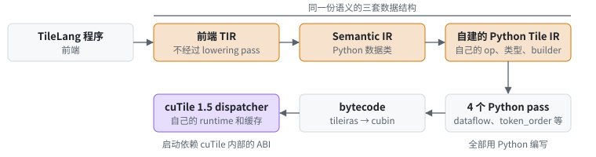
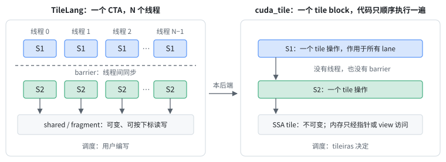
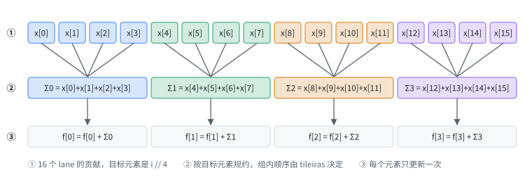
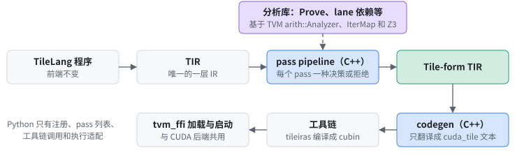

# RFC：CUDA Tile IR 后端的边界与设计

> 本文的英文版见 [`rfc.md`](rfc.md)。

<!-- toc -->
## 目录

- [动机](#动机)
- [背景](#背景)
- [1. 旧实现 Review 意见以及回应](#1-旧实现-review-意见以及回应)
- [2. 执行模型映射](#2-执行模型映射)
- [3. 内存层次转换](#3-内存层次转换)
- [4. 同步规约机制重构](#4-同步规约机制重构)
- [5. 内置函数转换](#5-内置函数转换)
- [6. 编译器行为对齐](#6-编译器行为对齐)
- [7. 编译栈](#7-编译栈)
- [8. 验证与维护](#8-验证与维护)
  - [8.1 验证与验收](#81-验证与验收)
  - [8.2 维护](#82-维护)
- [9. 合入计划](#9-合入计划)
  - [9.1 拆分原则](#91-拆分原则)
  - [9.2 PR 序列](#92-pr-序列)
- [10. 待定事项](#10-待定事项)

<!-- /toc -->

## 动机

我们的目标是为 TileLang 接入 CUDA Tile IR（后文简称 Tile IR）后端：TileLang 程序生成 CUDA Tile IR，由 tileiras 编译和调度。本后端只转换 Tile IR 能正确表达的语义，对于转换不了的语义在编译时报错并拒绝。本后端并不追求完美兼容所有 CUDA backend 的语义，而是期望借助 Tile IR 可以在某些场景下有性能提升。tileiras 会自行决定 layout、流水、warp specialization 和指令选择，并针对不同代际硬件进行优化，这样就使得开发者有机会在不改 kernel、无需手动实现复杂的前端 architecture-specific 的调度逻辑的前提下仅通过 autotuning 就拿到一个较好的性能，同时保持跨硬件的兼容性。

## 背景

在此前我们曾经提交过一个 PR，但是被指出存在一些问题，我们复盘后表示认同，因此我们进行了重新设计，在提交正式的 PR 前我们想先提交一份 RFC 文档以供社区评审。

为了方便审阅，我们会以 [tile-ai/tilelang#3247](https://github.com/tile-ai/tilelang/pull/3247) 的 review 意见为切入点，引出我们的解决方案和设计。

## 1. 旧实现 Review 意见以及回应

之前提交的 Tile IR 后端（下称第一版）链路如下：



社区和 maintainer 的意见主要集中在以下几点：

- **1. try-catch 过多，lowering 过程 case by case：** 代码中有过度的 try-catch，线程级代码靠逐个识别见过的写法来处理；lower 过程中更多的是在匹配已有的 DSL 写法，为每种 DSL 写法增加一个处理方式，导致可能存在“过拟合”，处理真实场景可能效果不佳。
- **2. 另建了一套 IR：** 第一版在 TIR 之外另建了 Semantic IR 和一套 Python 实现的 Tile IR，以及相应的 lower 流程。同一份语义在三套数据结构中各维护一遍，TileLang 每加一个特性三层都要改。
- **3. pass 用 Python 写：** 约 1.85 万行 Python，建议使用 cpp 重写。
- **4. 没有遵守新后端的标准集成指引：** 未按仓库指引进行集成。
- **5. 难以 review：** 一次提交的体量过大，不便 review。

针对问题 1：我们认为上一版的**编程模型**缺陷是最主要的原因：线程代码怎样对应到 tile 操作上没有一套统一的规则，就会导致遇到未预料的语义组合反复增加新 patch。因此我们会先阐述编程模型：依次说明执行模型的映射（第 2 章）、内存层次的转换（第 3 章）、同步和规约的重构（第 4 章）、内置函数的转换（第 5 章），以及编译器行为的对齐，即目前已知可能与 CUDA backend 不一致的地方（第 6 章）。

对于问题 2–4 涉及到的问题，我们将全程在 TIR pass 上进行 transform 和 lower 使用 cpp 重构，仅在 codegen 阶段产生 Tile IR，过程可能涉及到新增一些 attribute，具体编译栈和作为新后端的集成方式会在第 7 章中阐述。

关于代码量较大难以 review 的问题，我们会在第 9 章讨论 PR 拆分计划，并确认 maintainer 希望将什么作为验收标准以及其他待定事项。

---

## 2. 执行模型映射

TileLang 和 CUDA Tile IR 在编程模型上最显著的区别是：TileLang 除了有直接作用在 tile 级别上的 op（如 `T.gemm`、`T.copy`）之外，还可以在 tile 内的 element 级别上操作，写法有两种：显式使用 thread 编号的线程代码，和 `T.Parallel` 循环。tile 级别的 op 天生符合 Tile IR 的语义；element 级别的代码在 Tile IR 里没有直接对应的写法，因为 Tile IR 不暴露线程。



为了弥补这个 gap，我们参考了两类已有的做法：把 GPU 程序转换成 CPU 上的循环（[MCUDA](https://doi.org/10.1007/978-3-540-89740-8_2)、[POCL](https://doi.org/10.1007/s10766-014-0320-y)、[Polygeist](https://doi.org/10.1145/3572848.3577475)），和把 SPMD 程序向量化（[ISPC](https://doi.org/10.1109/InPar.2012.6339601)、[whole-function vectorization](https://doi.org/10.1109/CGO.2011.5764682)）。思路是把 Tile IR 视为一个单线程、多 lane 的执行者，把多个 thread 的并发操作转换成对整块 tile 的向量操作。

**把 tile 当成一个超宽的 SIMD 向量。** 源程序中 thread t（或 `T.Parallel` 的第 t 次迭代）的数据放在 tile 的第 t 个位置，这个位置称为 **lane** t。lane 只是数据的位置；运行时实际用多少线程由 tileiras 决定，与 lane 的个数无关。在这个类比下，线程代码里的概念都有向量上的对应物：

| 线程代码 | Tile IR | SIMD 里的对应物 |
|---|---|---|
| n 个 thread（或 `T.Parallel` 的 n 次迭代） | tile 的一个维度，长度为 n 向上取到的 2 的幂 | 向量的宽度 |
| thread 编号 `tx`（或循环变量 `i`） | 内容为 0, 1, 2, … 的 tile（`iota`） | 内容为 0, 1, 2, … 的向量 |
| 每个 thread 算出来不一样的值 | 一个 tile，每个 lane 一个元素 | 向量寄存器 |
| 每个 thread 算出来都一样的值 | 一个标量（0 维 tile） | 标量寄存器 |
| 一条 statement 只在部分 thread 上执行 | 带 mask 的 tile 操作，mask 是一个布尔 tile | 带谓词寄存器的向量指令（如 AVX-512、SVE 的 mask） |

**线程代码等价于一个并行循环。** “每个 thread 把这段代码执行一遍”，可以写成一个遍历所有 thread 的 `T.Parallel` 循环：各次迭代相互独立，可以并行。这个等价有两个条件：程序无竞争，lane 间无依赖。条件成立时，这个循环还可以在 statement 的边界上做 loop fission，拆成几个循环依次执行，结果不变。

**转换步骤。** 有了上面两点，转换分三步。下面用同一段源程序贯穿三步（`x`、`y` 是 128 个元素的 shared buffer，每个 thread 用 `tx` 访问自己的那个元素；`A_s`、`B_s`、`C_f` 是别处定义的 shared 和 fragment buffer）：

```python
tx = T.get_thread_binding()
x[tx] = A[bx, tx] * 2.0         # S1：线程代码
y[tx] = x[tx] + 1.0             # S2：线程代码
T.gemm(A_s, B_s, C_f)           # tile op
B[bx, tx] = y[tx]               # S3：线程代码
```

1. **线程代码改写成循环（pass `ThreadToParallel`）。** tile 级别的 op 保持不变；与 thread 相关的 statement，一段连续的代码整体改写成一个遍历所有 thread 的 `T.Parallel`，thread 编号换成循环变量。遇到 tile op 或 barrier，这一段就结束，后面的线程代码另起一个循环。此后程序里只剩 tile op 和 `T.Parallel`，线程代码和用户自己写的 `T.Parallel` 走同一套规则。

   改写之后，S1 和 S2 在同一个循环里，`T.gemm` 把它们和 S3 隔开：

   ```python
   for t in T.Parallel(128):
       x[t] = A[bx, t] * 2.0       # S1
       y[t] = x[t] + 1.0           # S2
   T.gemm(A_s, B_s, C_f)           # tile op 不进循环，保持原样
   for t in T.Parallel(128):
       B[bx, t] = y[t]             # S3
   ```

2. **以源程序的 statement 为边界做 loop fission（codegen）。** 这里对 for loop 做拆分是为了模拟 barrier，适配 Tile IR 的语义。Tile IR 的 op 以整个 tile 为粒度：下一个 op 拿到的一定是上一个 op 在所有 lane 上算完的结果，相当于 Tile IR 上看到的 op 之间天生带着 barrier。注意这里 runtime 时不一定会生成真正的 barrier 代码，也不代表 runtime 时所有的线程都执行完一个 op 才开始执行下一个 op，IR 顺序仅表示 statement 依赖关系，tileiras 后端会据此重建线程行为。

   拆开之后，含义等同于：

   ```python
   for t in T.Parallel(128):
       x[t] = A[bx, t] * 2.0       # S1 在 128 个 lane 上都做完
                                   # loop fission
   for t in T.Parallel(128):
       y[t] = x[t] + 1.0           # 再在 128 个 lane 上做 S2
   T.gemm(A_s, B_s, C_f)
   for t in T.Parallel(128):
       B[bx, t] = y[t]             # S3
   ```

3. **把每个循环向量化（codegen）。** 循环变量变成 `iota`，statement 里的每个运算生成一个作用于整块 tile 的 op。

   生成的 Tile IR（示意）。`x`、`y` 各成为一个 tile 值；“S1 做完再做 S2”体现为 `%y` 用到了 `%x`；`T.gemm` 直接对应一个 `mmaf`：

   ```text
   %v  = load_view_tko %A_view[%bx, 0]       // S1：一次读 A 的第 bx 行的 128 个元素
   %x  = mulf %v, 2.0                        //     对 128 个 lane 逐元素乘 2
   %y  = addf %x, 1.0                        // S2：用到 %x，所以排在 S1 之后
   %c1 = mmaf %as, %bs, %c0                 // T.gemm
   store_view_tko %y, %B_view[%bx, 0]       // S3：一次写回 128 个元素
   ```

这样得到的执行方式是：一条 statement 在所有 lane 上做完，再做下一条 statement。我们称之为**锁步执行**（lock-step execution）。

**控制流发散（divergent control flow）。** 不同 thread 可能走不同的分支，或者循环不同的次数。向量化以后代码只顺序执行一遍，所以和 SIMD 的做法一样做 if-conversion：把控制流变成数据流，用 mask 记录每条 statement 在哪些 lane 上生效。pass 标记出发散的分支，codegen 把两个分支都生成出来：
  ```python
  if tx < 5:
      y[tx] = x[tx] + 1
  else:
      y[tx] = x[tx] - 1
  ```

  ```text
  %t  = iota : tile<128xi32>           // lane 编号 0–127
  %m  = cmpi slt %t, 5                 // 条件算成 mask：每个 lane 一个真假值
  %y1 = addi %x, 1                     // then 分支，所有 lane 都算
  %y2 = subi %x, 1                     // else 分支，所有 lane 都算
  %y  = select %m, %y1, %y2            // 每个 lane 按 mask 取自己那一边
  ```

  纯计算两边都算，再用 `select` 取舍；store 和 atomic 带 mask；可能出错的操作数（经指针读内存、除数不是常量的除法）只在 mask 内求值。发散的循环同理：只要还有 lane 没退出就继续循环，已经退出的 lane 不再生效。

**为什么转换前后语义一致。** 我们的标准是：程序无竞争时，生成的 Tile IR 得到的结果，是源程序在 CUDA 语义下本来就允许的结果；竞争在 TileLang 里本来就是未定义行为。原因有二：

- 锁步执行是源程序允许的一种交错。把各 thread 的指令按某种先后穿插成一个执行顺序，称为一种交错；锁步执行就是“每个 thread 轮流做完同一条 statement”的那一种，它遵守所有 barrier。
- mask 准确还原了每个 lane 的控制流：每个 lane 执行的 statement、顺序和看到的值，都与它单独执行时相同。

这个论证依赖 TileLang 的三条语义，请上游确认是否与其理解一致：

- `T.Parallel` 的各次迭代相互独立，迭代具体分给哪个 thread 不可观察；
- 两个 thread 在两个 barrier 之间访问同一位置，其中至少有一次是非 atomic 的写，就是竞争，结果未定义；
- 与 thread 无关的代码每个 thread 都执行一次，所以不加守卫的副作用（如 `atomic_add(c, 1)`）发生“thread 数”次，生成的代码也让它发生同样的次数。

以下情况**不可以**安全向量化，我们会在编译期检查下列情况是否成立，如果属于下列情况则拒绝编译并报错。

- **有 thread 在等待另一个 thread**：生产者/消费者 warp、等待其他 thread 的 mbarrier、只有部分 thread 参与的 barrier。锁步执行时被等的 thread 排在后面，等不到。
- **在控制流发散的情况下使用 `T.Parallel`**（如 `if tx < 64: for i in T.Parallel(128)`）：结果取决于迭代分给哪个 thread。

这两种写法在现有 TileLang kernel 中经常出现于手写 warp specialization 或者是其他精细化调度的 kernel。对于这些 kernel 用户手动指定了调度方式，和 Tile IR backend 的设计初衷相悖，所以拒绝是一种合理的选择。

## 3. 内存层次转换

第二个编程模型上的差异是内存模型：TileLang 提供了 PTX 上的几乎所有存储层次：片上 buffer 类型有 local fragment 和 shared，而 Tile IR 并没有显式暴露片上内存层次。用户看到的只有 global memory 和代表片上数据的 SSA tile；且 TileLang 上 buffer 可以修改，但是在 Tile IR 中 tile 值是 SSA，不可变。

为了调和内存模型的差异，我们需要服从以下几个映射规则：

**单条 statement 内的访存模型转换和顺序**

因为 Tile IR 上只有一种 tile，所以需要把不同的 TileLang buffer 按照 TileLang 语义规定的行为映射到 SSA tile 值上：

- `local`：线程间独立，只需为 tile 新增一个 lane 维度，每个 thread（lane）都保有一份自己的 tile，例：

  ```python
  r = T.alloc_local((4,), "float32")      # 每个 thread 一份，4 个元素
  tx = T.get_thread_binding()
  for k in T.serial(4):
      r[k] = A[bx, tx * 4 + k]
  ```

  ```text
  %r : tile<128x4xf32>                    // 多出来的第一维是 lane：第 t 行是 thread t 的 r[0..3]
  ```

- `shared`：CTA 内共享，所以按原维度做 mapping 到一个 tile 上，得益于第 2 章中定义的锁步执行机制，我们可以把不同 thread 访问一块 shared 的行为转化为一次对一块 buffer 上不同 lane 的同步访问行为，如果发生控制流发散则通过 mask 和 `select` 的机制取两边结果。未定义行为如发生竞争则和 CUDA backend 一样不检查不处理。
    在 shared 上的访问从处理方式来看可以分为两种。第一种是规整的访问：tile op 读写一整块区域（如 `T.copy(A[bx, :], a)`），或者编译时能证明下标属于下面两种形式之一：不随 lane 变化（如 `s[0]`）；每一维是一个 lane 坐标的仿射函数 `stride * t + offset`，其中步长是 2 的幂、偏移对齐，并且各维用到的 lane 坐标互不相同（如 `a[t]`、`a[t // 4, t % 4]`）。第二种是不规整的访问，即其余的访问以及证不出来的访问（如 `a[idx[t]]`、`a[i + j]`），常见于每个 thread（lane）需要访问的地址是 runtime 值；或者是取地址、atomic 更新这类需要真实地址的情况。

    对于规整的情况可以直接在 tile 上完成操作：

    ```python
    a = T.alloc_shared((32, 4), "float32")
    s = T.alloc_shared((1,), "float32")
    for t in T.Parallel(128):
        a[t // 4, t % 4] = x[t] + s[0]
    ```

    ```text
    %s1 = broadcast %s : tile<128xf32>        // s[0]：所有 lane 读同一个元素，对应广播
    %y  = addf %x, %s1
    %a  = reshape %y : tile<32x4xf32>         // a[t // 4, t % 4]：128 个 lane 排成 32 × 4，对应 reshape
    ```

    写 `a` 就是产生一个新的 tile 值，之后读 `a` 直接用这个值；`a` 和 `s` 的 alloc 不生成代码。上面的 Tile IR 是示意，op 的写法有简化。

    理想上，对于不规整的情况落到 SSA 上分为三步：第一步从待访问的 buffer（tile）中取出所有需要访问的元素组成一个新 tile，也就是 gather 操作，第二步是在新 tile 上进行想要的操作，第三步是 scatter 回源位置。

    ```text
    // 示意：gather 和 scatter 这两个 op 在 cuda_tile 里并不存在，这里只是为了解释这三步的含义
    // %shm 在 DSL 里是一块 shared buffer
    %k  = load_view_tko %idx_view[%bx, 0]       // 128 个下标，到运行时才知道
    %g  = gather %shm, %k                       // 第一步：按下标从 tile %shm 里取出 128 个元素，组成一个新 tile（op 仅用作表意，dialect 里不存在）
    %r  = mulf %g, 2.0                          // 第二步：在新 tile 上做想要的操作
    %a1 = scatter %shm, %k, %r                  // 第三步：按下标写回原位置，得到新的 tile 值 %a1（同样不存在）
    ```

    但是实际上目前 CUDA Tile IR 还没有显式暴露 `cuda_tile.gather` 和 `cuda_tile.scatter`，仅有从 global memory 存取数据的 gather_load 和 scatter_store 操作，所以这里我们会在 global memory 上进行一个 round trip，这里是已知可能造成性能 regression 的缺陷。

    ```python
    a = T.alloc_shared((128,), "float32")
    for i in T.Parallel(128):
        a[i] = A[bx, i] * 2.0
    for i in T.Parallel(128):
        B[bx, i] = a[idx[bx, i]]            # 下标来自运行时数据
    ```

    生成的 Tile IR 做的事情使用伪代码表示（写成 Tile IR 会比较冗长；这里 `W` 是 global memory 里分给本 kernel 的一块临时空间，每个 block 用其中自己的一段）：

    ```text
    v = A[bx, 0:128] * 2.0               // a 的值
    W[bx * 128 + i] = v[i]               // 存进 global memory
    k = idx[bx, 0:128]                   // 128 个下标
    r[i] = W[bx * 128 + k[i]]            // 按地址读：每个 lane 读到 a 的第 k[i] 个元素
    B[bx, 0:128] = r
    ```

- `fragment`：大部分和 shared 一致，同样使用和原维度一样的 tile，区别有两点：

    1. **多个 lane 访问同一个元素时，结果是有定义的。** 在 shared 上这是竞争，属于未定义行为，后端不检查。在 fragment 上，CUDA 后端在 fragment 的 layout 先确定时，这几次访问落在同一个 thread 上，按循环顺序依次生效；本后端按这个结果来定义（第 6 章）：冲突更新必须可以写成规约形式，即 `f[element] = f[element] op v`；冲突写在能确定最后一次写入的迭代时取它的值，否则要证明写入的值相同，证不出则拒绝编译。
    2. **不能用 thread 编号做下标。** `a[tx]` 对 shared 是合法的：每个 thread 访问自己的那个元素，对应 lane t 访问第 t 个元素。`f[tx]` 对 fragment 的含义取决于 layout 把哪些元素分给了这个 thread，而 layout 在本后端由 tileiras 决定，所以拒绝编译。fragment 只能用 `T.Parallel` 的循环变量访问。

**不同访存 statement 间的转换和顺序**

**Tile IR 的访存 op：** 从 global 中存取数据在 Tile IR 上有两种接口：`load/store_tko` 和 `load_view/store_view_tko`，其中 view 接口用于下标是 lane 编号的仿射函数的访存，即可以用 base、shape、stride 来表示一整块访问，想用 TMA 必须用 view 接口；tko 表示 token，标记访存操作的顺序，tile ir 默认所有访存都是可以重排的，除非显式使用 token 排序，如果 op2 应当发生在 op1 之后，那么 op1 返回的 token 应当作为参数传给 op2。

这里带来的映射规则是，需要分析 TileLang 程序的访存操作 def chain，并用 token 串起来，并且分析下标是否仿射以启用 TMA，会有专门 pass 判断这两点。

## 4. 同步规约机制重构

TileLang 程序的结果依赖两种先后：thread 之间靠同步操作建立的先后，以及同一条 statement 里多个 lane 更新同一个元素时的先后。Tile IR 里没有 thread，一个 op 一次写完所有 lane，这两种先后都要重新建立。前一种称为同步的重构，后一种称为规约的重构。

**同步机制重构**

TileLang 里的同步分两层。CTA 内部有：所有 thread 都参与的 barrier（`T.sync_threads()`，以及 CUDA 后端自动插入的 barrier）；异步拷贝的等待（`cp.async` 加等待、TMA 加 mbarrier 等待）；thread 之间互相等待的写法（等待其他 thread 的 mbarrier、warp 之间的生产者/消费者）。CTA 之间有：atomic，以及经由 global memory 的自旋。

**所有 thread 都参与的 barrier 不生成代码。** 这种 barrier 要求的是“所有 thread 都做完它前面的代码，才能开始它后面的代码”。这里已经由第 2 章声明的锁步执行机制保证。例如：

```python
tx = T.get_thread_binding()
a[tx] = A[bx, tx] * 2.0
T.sync_threads()                    # 所有 thread 写完 a，才能规约
T.reduce_sum(a, s, dim=0)
```

```text
%v = load_view_tko %A_view[%bx, 0]
%a = mulf %v, 2.0
%s = reduce %a add                  // 用到 %a，所以排在写 a 之后；barrier 没有对应的 op
```

**异步拷贝改成同步拷贝。** `cp.async` 加等待、TMA 加 mbarrier 等待，都改成在发起处同步完成的拷贝，等待本身删去。这样改不会改变结果：要区分“发起时就拷完”和“等待时才拷完”，程序必须在等待之前读拷贝的目标，而这本身就是竞争。具体编译后的结果用不用 TMA、怎样流水，内部的异步 pipeline 如何构建，都由 tileiras 决定。

**重构不了的同步在编译时拒绝。** 有 thread 在等待另一个 thread 时，锁步执行里被等的 thread 排在后面，等不到（第 2 章）。属于这一类的构造有：

- 等待其他 thread 的 mbarrier；
- named barrier，或只有一部分 thread 参与的 barrier（比如 `if (tid < 32): for i in T.Parallel(64): Barriers`）；
- 在片上 buffer 上自旋等待；
- warp 之间的生产者/消费者分工。

**CTA 之间的同步直接对应。** CTA 之间只通过 global memory 交互，TileLang 和 Tile IR 在这一层的内存模型相同：普通访问对应 `weak`，atomic 对应 `cuda_tile` 的 atomic op。在 CTA 之间等待，应当用 atomic：把读写成 acquire 语义的 atomic 读，Tile IR 能保证它读到别的 CTA 已经写入的值。用普通读写等待是未定义行为，本后端不检查，也不保证和 CUDA 后端的表现一致：如下例在 Tile IR 上可能直接放行，也可能挂起。

```python
# CTA 0
flag[0] = 1                     # 普通的写
# CTA 1
while flag[0] == 0:             # 普通的读，循环等 CTA 0
    pass
```

**规约的重构**

**问题。** 对于 fragment 上的冲突写更新，TileLang 上表达的语义可能是单个 thread 在多轮迭代中对同一个元素重复更新。以

```python
for i in T.Parallel(16):
    frag[i // 4] += x[i]
```

为例，每四次迭代更新同一个元素。源程序里这四次依次执行，后一次读到的是前一次更新后的值，所以元素里加上了全部四个 `x[i]`。如果按第 2 章的办法直接向量化，这条 statement 变成对所有 lane 的一次读、一次加、一次写：每个 lane 读到的都是更新之前的值，写回时四个 lane 写同一个元素，只能留下一个。结果是元素里只加上了一个 `x[i]`，另外三个丢了。

**做法。** 先把写往同一个元素的各次贡献规约成一个值，再对每个元素只更新一次。我们把这个操作称为 **combine**。它就是数据并行编程里的 reduce-by-key：键是目标元素的下标，值是各次迭代的贡献。Thrust 的 [`reduce_by_key`](https://github.com/NVIDIA/cccl/blob/main/thrust/thrust/reduce.h)、PyTorch 的 [`scatter_reduce`](https://docs.pytorch.org/docs/stable/generated/torch.scatter_reduce.html) 和 [OpenMP](https://www.openmp.org/specifications/) 的数组规约都是这个操作。



上面的例子里，写往同一个元素的 lane 构成规整的分组（每组 4 个），所以把贡献 reshape 成“元素数 × 每组的 lane 数”，沿组内那根轴规约，再和旧值更新一次（示意）：

```text
%g  = reshape %x : tile<4x4xf32>         // 16 个贡献按目标元素分成 4 组，每组 4 个
%r  = reduce %g add, dim = 1             // 每组规约成一个值
%f1 = addf %f, %r                        // 每个元素只更新一次
```

**判定规则。** 一条读改写自身 buffer 的 statement，按下面的顺序处理：

1. 证明了不同 lane 写不同元素（如 `f[i] = f[i] * 2 + x[i]`）：没有冲突，直接向量化。
2. 证不出，且更新是规约形式 `f[e] = f[e] op v`：改写成 combine。`op` 可以是 `+`、`-`、`max`、`min`、`&`、`|`、`^`，并且 `v` 和外层的条件都不读 `f`。只有这种形式，“依次更新”和“先规约、再更新一次”的结果才相同。
3. 证不出，且不是规约形式（如 `f[i // 4] = f[i // 4] * 2 + x[i]`）：在编译时拒绝。

“证明”指的是在编译时证明下标到元素的映射一一对应；证不出不等于真的有冲突，这时走第 2 步或第 3 步，不会算错。reducer 的更新走同一套规则。

**两个已知限制。**

- 目标下标不规整的累加更新（如 `f[idx[t]] += x[t]`）：哪些 lane 写往同一个元素到运行时才知道，目前不支持，在编译时报错。
- 循环次数到运行时才知道的 `T.Parallel(n)`：按固定宽度分块，一块一块顺序执行，最后一块里超出 `n` 的迭代用 mask 挡住。每一块内部先规约，块与块之间依次累加到同一个 buffer 上，不整除的加 mask。

**和 CUDA 后端的差异。** CUDA 后端逐个累加；combine 先规约、再更新，规约时的结合顺序由 tileiras 决定，reduce 顺序不同可能会导致浮点数不 bit-equivalent。第 6 章会列出这一项和其他已知的不一致。

## 5. 内置函数转换

tile 级别的 op（`T.copy`、`T.gemm`、`T.reduce`、`T.cumsum`、`T.fill` 等）在 Tile IR 里有直接对应的 op，逐个翻译即可，例如 `T.gemm` 对应 `mmaf`。本章说明的是另外几类内置函数：它们在 Tile IR 里没有直接对应的 op，或者对应的 op 用法不同，需要后端做一次转换。

**warp 内的集体操作（warp shuffle、vote、warp reduce）。** 这些操作在 thread 之间交换或汇总数据，Tile IR 没有专门的 op。后端先把 n 个 lane 每 32 个一组排成 `[n/32, 32]` 的形状，一行就是一个 warp；然后用已有的 op 组合出来：

- warp shuffle 是每个 lane 读同一个 warp 里另一个 lane 的值，对应在每一行内部把元素重新排列；
- vote 和 warp reduce 是对一个 warp 里所有 lane 的值求与、或、和、最大值等，对应对每一行求出一个结果，再广播给这一行的每个 lane。

shuffle 的宽度和来源 lane 要在编译时确定。

**随机数（`T.rng_init`、`T.rng_rand*`）。** CUDA 后端用的是 curand 的 Philox4_32_10，每个 thread 一个生成器。Tile IR 没有随机数的 op，后端把 Philox4_32_10 展开成每个 lane 一份状态上的整数运算，算出的数与 CUDA 后端逐位相同，这一点由与 CUDA 后端逐位比较的测试保证。两个条件不满足时在编译时报错：每次取数对应的 `rng_init` 在所有执行路径上是同一个；取数一定会被求值。float32 正态分布的随机数不支持。

**PDL（`T.pdl_sync`、`T.pdl_trigger`）。** PDL 让前后两个 kernel 重叠执行。Tile IR 有对应的 op，直接翻译；它们是同步操作，所以连接所有的 token 链（第 3 章）：

```text
T.pdl_trigger()   %j = join_tokens %t3, %u1                 // 连接所有 token 链
                  %p = gdc_launch_dependents_tko token = %j
```

**grid 同步（`T.sync_grid`）。** 它要求 grid 内所有 CTA 都到达同步点才继续，Tile IR 没有对应物。后端在同步点把 kernel 拆成几个，在同一个 stream 上依次 launch：前一个 kernel 的所有 CTA 执行完，后一个才开始，这正是 grid 同步要求的先后。条件是同步点在 kernel 的顶层（不在循环或条件里），并且片上 buffer 的内容不跨过同步点；不满足时在编译时报错。

**没有对应物的内置函数**在编译时拒绝：内联汇编，没有定义映射的 `call_extern`，显式的 `wgmma`/`tcgen05`/`ldmatrix`/`mma`，显式的近似 intrinsic（`T.__log`、`T.__sin` 等），`T.cast` 的舍入模式和饱和参数。

## 6. 编译器行为对齐

接受的程序在本后端和 CUDA 后端上应当得到相同的结果。本章列出目前已知可能不一致的地方，分成四类。除了这里列出的，出现不一致就是本后端的缺陷。

**数值。** 逐元素的 `+`、`-`、`*`、`/`、比较和默认舍入的类型转换，在相同的浮点开关下与 CUDA 后端逐位一致。不一致的有三处：

1. **规约的结合顺序。** `T.reduce` 和第 4 章的 combine，相加的先后由 tileiras 决定，浮点结果可能差在最后几位。
2. **fma 收缩。** `a*b ± c` 像 nvcc 一样收缩成 fma。但乘积被多次使用，或者经过 fragment 时，nvcc 是否收缩取决于它看到的代码形状，两边可能不同。
3. **fast math 下的 `log`、`log2`、`sin`、`cos`、`tan`、`pow`。** Tile IR 暂时不能对这些运算要求近似计算，本后端用精确运算，CUDA 后端用近似指令。`exp` 和 `tanh` 两边都用近似计算。

**调度。** layout、流水、warp 分工和指令选择都由 tileiras 决定。TileLang 的调度注解里，Tile IR 有对应 hint 的会转发（如 `T.copy(disable_tma=True)` 对应 `allow_tma = false`），没有对应 hint 的（如 `T.use_swizzle`）会被抛弃，并给出 warning。两边的 hint 怎样对应，见第 10 章问题 7。

**CUDA 后端自身结果不确定的地方。** 有两种程序，CUDA 后端的结果取决于它内部的选择，本后端给出一个确定的结果：

- 多次迭代更新同一个 fragment 元素（如 `f[i // 4] += x[i]`）：CUDA 后端的结果取决于 layout 推断，有时是全部贡献的累加，有时每份副本只加了一次。本后端的结果总是全部贡献的累加（第 10 章问题 6）。
- 有竞争的程序（第 3 章 shared 上的竞争，第 4 章 CTA 之间用普通读写等待）：两边的表现可能不同，后者在 Tile IR 上可能直接放行，也可能挂起。

## 7. 编译栈



pass 和 codegen 用 C++ 实现；Python 部分只有注册、pass 的排列、工具链调用和执行适配。**Tile-form TIR** 是 codegen
接受的 TIR 子集：pass 做出的每个决策都已写在 IR 里，并经过校验。这些决策包括：某个 buffer 用哪种表示；某次全局内存
访问用 view 还是指针 tile（Tile IR 的两种访存接口，前者整块读写，后者按地址逐元素读写）；哪些操作数只能在 mask
内求值。我们的做法是新增一组 `tl.tileir.*` intrinsic 和属性来记录这些决策；这种
做法上游是否认同，见第 10 章问题 2。各部分的分工如下：

- **pass**：一个 pass 只负责一种决策或一类拒绝。它自行完成所需分析；它的证明义务（proof obligation：采用
  某种做法之前必须先证明成立的条件）一律交给 `Prove` 证明，这是唯一的证明入口；然后把决策写入 IR。它只添加决策，不推翻前面 pass 的决策，不替其他 pass 兜底，也不按
  kernel 名或形状做选择。
- **codegen**：只做翻译——构造结构化 SSA、按别名类串接 token、在记录好的域和 mask 上生成 statement。它不分析、
  不证明、不拒绝、不回退；契约被违反说明编译器存在缺陷。
- **诊断**：只有一种格式，写明构造、违反的条件和类别（不支持，或“尚未实现”），有替代写法时一并给出，并指向
  用户源码。不支持的构造由拒绝阶段诊断；需要等后续决策才能判断的实现限制，由做出该决策的 pass 诊断。

**集成方式：** 上游 `tilelang/backend/README.md` 把后端分为 target backend 和 execution backend 两层，
并规定只有出现新的产物或运行时约定时，才新增 execution backend。本后端复用 `PassPipeline`、host/device 拆分和
packed API、`tvm_ffi` 的 host ABI 和模块加载，产物仍是 cubin，因此实质上是 `cuda` target 上的一个 target backend
变体；新增名为 `tileir` 的 `ExecutionBackendSpec` 只是为了让用户能选中该变体。

**编译流水线。** 流水线就是上图中的“TIR pass pipeline”：输入 TIR，输出经校验的 Tile-form TIR。它分为七个阶段（下表），每个阶段实现第 2–5 章的一部分，并有出口不变式。

| 阶段 | 职责 | 对应章节 | 出口不变式 |
|---|---|---|---|
| 规范化 | 线程查询改写成下标算术，规范 reducer、随机数、per-thread tile op 等写法；保留源码位置 | 第 2 章的准备 | 下标只含循环变量和 lane 变量 |
| 拒绝 | 对照用户源码一次性诊断不支持的构造和可在源码上判断的实现限制 | 第 2–5 章 | 只剩支持的构造 |
| 提升 | 把线程代码改写成 lane 域上的 statement；处理 barrier、异步拷贝、集体操作和 grid 同步 | 第 2、4、5 章 | 没有线程下标；每条 statement 要么与 lane 无关，要么在某个 `T.Parallel` 里 |
| 展开 | tile op 展开成 tile 级形式；冲突更新改写成 combine | 第 4、5 章 | 每次更新要么已证明写不同元素，要么是 combine |
| 决策 | buffer 的表示、全局内存访问用哪种访存接口（view 还是指针 tile）、lane 控制、需要守卫的操作数、别名类和浮点语义 | 第 3、6 章 | codegen 需要的每个决策都已记录 |
| 校验 | 在最终的设备端 IR 上检查 Tile-form 契约 | 本章 | Tile-form TIR |
| host/device 拆分 | 标准的拆分和 packed API；分配 workspace | 第 3 章 | — |

## 8. 验证与维护

### 8.1 验证与验收

我们计划将验收分为以下四个部分以验证数值正确性和语义一致性：

1. **语义一致性测试**：依照第 2–5 章的规则，为每类构造构建正例和反例；正例与 torch/CUDA backend 参考比较，反例须被
   诊断并拒绝。这部分是本后端自己的测试，包含：
   - 契约测试：每个 pass 至少一个接受用例和一个拒绝用例；
   - codegen 测试：检查每种映射生成的 `cuda_tile` 文本；
   - 数值测试：与 torch 参考比较，逐元素的浮点运算还与 CUDA 后端比较。
2. **TileLang 自带的单元测试**：对于已有的 UT，选中本后端运行。
3. **TileLang 自带的示例和公开的 kernel 库盲测**：原有测试不经修改即通过；仅因浮点规约顺序不同而失败的逐项列出
   （第 10 章问题 3）。
4. **多形状盲测**：除默认形状外，还在非 2 的幂、尾块和动态形状上运行。

数值上，kernel 的正确性由它自己的正确性测试判定，用这些测试自己的参考和
容差；没有这类测试的 kernel 与它的 torch 实现比较，连 torch 实现也没有的才与 CUDA 后端比较。只有用来判定该 kernel 的
测试本身要求逐位一致时，才要求与 CUDA 后端逐位一致（第 6 章）。

需要哪些测试和数据、各部分的范围和通过标准，待与上游确认（第 10 章问题 1）。

### 8.2 维护

关于 Tile IR backend 的维护：我们希望兼容 TileLang 本身的 CI 并补充本 backend 专属的 test，并希望合入的是一个经过
较为完整的验证的版本，并在此基础上：

- **工具链**：Tile IR 工具链的维护依赖于随 CUDA Toolkit（CTK）发布的 tileiras、ptxas 和 libnvvm，后端相关的 feature
  更新和 bug 修复会随 CTK 发布而更新，我们会在 CTK 每个版本发布后测试并更新工具链；TileLang 侧遇到的 CUDA Tile IR
  的 bug 我们也会同步向内部开发团队反馈。
- **TileLang lowering 侧**：我们希望和社区共同维护，及时跟进 TileLang 本体的新 feature，接受社区的反馈 issue 并进行
  修复/优化的同时 review/接受社区的 PR。
- **Skills**：为了方便 coding agents 进行开发和问题定位，我们还会提供相关 skills。

## 9. 合入计划

完整方案一次提交难以 review，这是第一版的问题之一。本章说明怎样拆分、按什么顺序合入。

### 9.1 拆分原则

- 按“需要哪一类分析”分层，每个 PR 的边界用访问的类别（第 3 章）和拒绝的类别写明，不按 kernel 名划分；
- 每个 PR 合入后都能把一批真实 kernel 从源程序跑到正确结果，以 8.1 节的标准衡量。PR 1 内部的各个 commit（9.2 节）
  不单独要求这一点；
- 从第一个 PR 起，不支持的构造即须诊断并拒绝，不出现静默错误的结果；
- 每个 PR 写明覆盖第 2–5 章的哪些部分。

### 9.2 PR 序列

PR 序列（下表）分两批：

- **第一批（PR 1）** 是后端能工作的最小整体：注册、分析、拒绝、决策和 codegen 缺一不可，合在一起才能把一个 kernel
  从源程序跑到结果。代码量较大。
- **第二批（PR 2–6）** 都只依赖 PR 1，彼此之间没有依赖。拆开只是为了便于 review：可以并行 review，
  也可以按任意组合打包合入，具体怎样打包听上游的意见。

拆分粒度和合入方式待与上游确认（第 10 章问题 5）。

| PR | 接受的程序 | 新引入的机制 | 覆盖的设计 | 依赖 |
|---|---|---|---|---|
| 1 | 只用 tile op 的程序（`copy`、`gemm`、`reduce`、`scan`、`fill`）；规整的 `T.Parallel`：每个 lane 访问自己的元素，或所有 lane 访问同一元素；与 lane 无关的控制流；随 lane 变化的 `if` | 框架和流水线、codegen 的基础部分、校验、tile 值表示、token 顺序、浮点开关、`Prove`、访问分类，以及完整的拒绝阶段 | 第 2、3 章中规整访问的部分，第 6、7 章 | — |
| 2 | 规整下标的冲突更新；reducer | combine | 第 4 章 | 1 |
| 3 | 下标不规整的读写；atomic，包括全局 atomic 和对片上 buffer 的 atomic 更新 | global memory 里的 workspace 及其分配 | 第 3 章 | 1 |
| 4 | 随 lane 发散的循环和提前退出；循环次数到运行时才知道的 `T.Parallel` | 带 mask 的循环；按固定宽度分块 | 第 2、4 章 | 1 |
| 5 | `T.Parallel` 之外使用线程下标的代码：单线程守卫、warp 集体操作、统一的 barrier、grid 同步 | 提升阶段 | 第 2、4、5 章 | 1 |
| 6 | 几个独立的小项：hint 转发；PDL；随机数；float4 | 各小项互不依赖，合成同一个 PR | 第 5、6 章 | 1 |

**PR 1 的拆分提交方式：** 我们不把 PR 1 拆成更小的 PR，而是以多个 commit 的形式放进同一个 PR，每个 commit 支持
一部分程序，可以逐个 commit review。后一个 commit 建立在前面的 commit 之上。

| Commit | 处理的程序 |
|---|---|
| 1 | 框架；只用 tile op 的程序（`copy`、`gemm`、`reduce`、`scan`、`fill`） |
| 2 | 规整的 `T.Parallel`：每个 lane 访问自己的元素，或所有 lane 访问同一元素 |
| 3 | 与 lane 无关的控制流 |
| 4 | 随 lane 变化的 `if` |

**每个 PR 的测试边界：** 每个 PR 定义三组用例和一份例子名单：

- **接受集**：该 PR 新接受的每个类别至少一个最小程序，数值与 torch 参考比较，另有一条生成文本的测试；
- **边界集**：后续 PR 才接受的每个类别一个最小程序，在本 PR 中必须被拒绝，诊断注明“尚未实现”和所属类别。后续
  PR 合入时，这些用例从拒绝转为接受；这一转变在此预先声明；
- **永久拒绝集**：本后端不支持的构造的用例，从 PR 1 起全部存在，此后不变；
- **例子名单**：必须不经修改即通过的 TileLang 示例和 kernel

| PR | 接受的程序示例 | 边界集示例（括号内是接受它的 PR） |
|---|---|---|
| 1 | `T.Pipelined` 中的 `T.copy` → `T.gemm` → `T.copy`；`T.reduce_max(a, m, dim=1)`；`T.cumsum`；`C[i, j] = A[i, j] + B[i, j]`；`a[t // 4, t % 4]`；读 `s[0]` | `f[i // 4] += x[i]`（2）；`y[i] = a[idx[i]]`、`T.atomic_add(a[i], 1)`（3）；随 lane 的 `break`、循环次数到运行时才知道的 `T.Parallel`（4）；`if tx == 0: …`（5） |
| 2 | `f[i // 4] += x[i]`；reducer 的更新 | — |
| 3 | `y[i] = a[idx[i]]`；`T.atomic_add(a[i], 1)` | — |
| 4 | 随 lane 的 `break` 和 `continue`；`T.Parallel(n)`，`n` 为运行时的值 | — |
| 5 | `if tx == 0: …`；warp shuffle 和 warp reduce；`T.sync_grid` | — |

下标不规整的累加更新（如 `f[idx[i]] += x[i]`）目前不支持，在所有 PR 中都报“尚未实现”。

维护计划上随 CUDA Toolkit 更新扩展：CUDA Toolkit 提供新的 Tile IR op（例如对 tile 值的 gather/scatter）后，用它们支持
下标不规整的访问等目前无法处理、或只能经 global memory 处理的写法，并提升性能。反方向上同时适配 TileLang 的新 feature。

## 10. 待定事项

以下问题需要上游确认是否符合规范/预期。

1. **测试与验收**：我们会随 PR 提供单元测试、示例（examples）和一些补充的真实 kernel 上的正确性和性能测试结果。上游还希望
   看到哪些测试数据，做到什么程度可以合入？（8.1 节）
2. **对 TIR 的扩展**：我们会新增一些 Tile IR 后端专有的 intrinsic 和属性（名字以 `tl.tileir.` 开头），用来把
   pass 的决策写在 TIR 中。例如 `tl.tileir.block_storage` 记录一个 buffer 用哪种表示，`tl.tileir.combine_into` 表示一次
   combine。期间可能涉及一些共用目录的改动（第 7 章）。
3. **浮点规约结果**：与 CUDA 后端的差异是否可以接受？是否存在必须逐位一致的 kernel？（第 4、6 章）
4. **注册方式与支持级别**：我们计划这样注册。target 方面不新增种类，沿用 `cuda` target，加一个 `tileir` 键来选中
   本后端。execution backend 方面注册一个名为 `tileir` 的条目，用户写 `execution_backend="tileir"` 即可选中；它不带
   新的运行时，加载和启动复用 TVM-FFI。本后端自己提供的只有 pass 序列、device codegen 和调用 tileiras 的一步，host 端
   代码生成和 host/device 拆分都复用框架已有的实现。这样注册是否符合上游对后端的要求？另外，进入上游时是什么支持
   级别（CuTe DSL 为 Experimental），升为 Supported 的条件是什么？（第 7 章）
5. **合入范围与计划**：是否需要对 PR 进行拆分？如上文中合入计划所示。
6. **多次迭代更新同一个 fragment 元素的结果**：`T.Parallel` 中几次迭代更新同一个 fragment 元素时（如
   `f[i // 4] += x[i]`），TileLang 期望的结果是什么？CUDA 后端目前的结果取决于 layout 推断：fragment 的 layout 先确定时
   按循环顺序累加；否则各次迭代写各自的副本，每份副本只加了一次。本后端按循环顺序的结果来定义，即全部贡献的累加。
   这样是否符合上游的预期？（第 4、6 章）
7. **性能 hint 的对应方式**：CUDA Tile IR 有一组与性能相关的 hint，如 `num_cta_in_cga`、`occupancy`、`allow_tma`、
   `num_worker_warps_per_cta`。它们与 TileLang 提供的调度注解有相似之处，但并不完全重合。有两种做法，想征求上游的意见：
   1. 沿用 TileLang 现有的注解：语义相近的映射到 Tile IR 的 hint，Tile IR 不支持的（如 `T.use_swizzle`）抛弃并给出
      warning。用户不需要改 kernel。
   2. 把 Tile IR 独有的性能 hint 作为新的选项加入 tuning space。表意更清晰，但用户要为本后端单独写 hint。

   （第 6 章）
