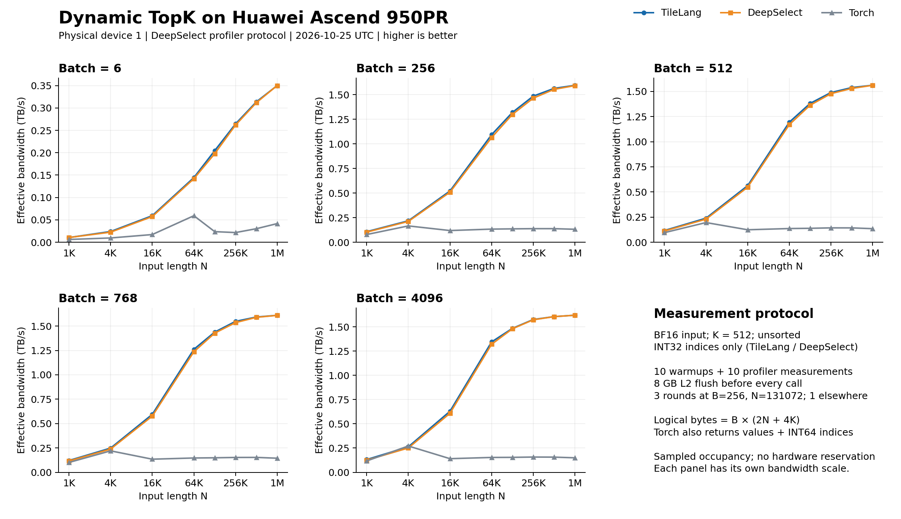

# Huawei Ascend TopK

A BF16 TopK macro written entirely in TileLang SIMD, following DeepSelect
`bfa4507d935f17ebfc3d0f00ff7d3c9a4d0e5c18`: histogram radix selection,
triple-buffered transfers, and optional ascending index radix sort. No external
kernel is called. `deepselect.LICENSE` retains the adapted implementation's MIT notice.

## Usage

```python
import torch
from example_topk import topk

values, indices = topk(x, 512, indices_type=torch.int32)
_, indices = topk(x, 513, indices_type=torch.int32, return_value=False)
```

The wrapper follows DeepSelect's Python argument order and returns `(values,
indices)` with logical shape `[B,K]`; values are `None` when disabled. Pass
`indices_type=torch.int32`: DeepSelect's shared default is INT64, which this
backend rejects. `output_idx` accepts a preallocated aligned output tensor.

Only the capacity tier (512/1024/4096), `sorted_index`, and
`abort_when_nan_found` select a compiled kernel. Batch size, N, exact K, all row
strides, `return_value`, optional end/offset presence, and fill values are runtime
parameters. Changes within a tier reuse the same compiled kernel. Tensor contents
are never cache keys. JIT compilation occurs on the first call to each variant.

`make_topk_macro(capacity, sorted_index=..., abort_when_nan_found=...)` returns
`select(X, I, V, end, offsets, row, n, k, return_value, has_end, has_offset,
index_fill, value_fill_bits)`. See the example for dynamic buffer declarations.

- Huawei Ascend 950; BF16 input, INT32 indices; `1 <= K <= capacity`, `0 <= N < 2**21`.
- Unit inner strides and non-overlapping, 32-byte-aligned row strides.
- `begin`, `hint`, and sorting by value are unsupported, matching the original backend.
- Callers must ensure `0 <= end[i] <= N`. Short rows pad outputs; offsets do not
  apply to padding. Equal scores may select different indices from Torch.
- NaN checking is always enabled. Disabling abort fills affected index rows with
  `0x3f3f3f3f`; values are undefined. Enabling abort issues a device assertion.
- The macro owns 248 KiB UB and events 0..3. Call once per block with
  `tl.enable_auto_schedule=False` and `tl.disable_thread_storage_sync=True`.
  Direct macro callers must validate buffer layouts and runtime parameter ranges.

## Validation

```bash
pytest -q test_topk.py
python example_topk.py --k 512
python example_topk.py --k 4096 --sorted-index
```

The final implementation passed 66 example tests and 10 separate focused tests
on Huawei Ascend 950PR. Coverage includes K tiers, dynamic lengths/strides,
offsets, padding, NaN, index sorting, values, preallocated output and compiled
kernel reuse, including N=2/3 rows with exactly sized backing storage. Focused tests add nonzero aligned tensor storage offsets and an
INT64-stride ABI case; that large-stride case uses one row. The large benchmark
also exercises row byte offsets beyond 32 bits. No DeepSelect library is
required for the example tests.

All six non-abort capacity/index-order variants compiled. Tests also cover
enabled abort with non-NaN input. Generated CCE retains N, K, flags, fills and
INT64 strides as runtime arguments. Actual device disassembly confirms
histogram, compaction and radix-sort gather/scatter instructions; it is not an
instruction-by-instruction equivalence proof.

## Implementation

The macro preserves the original page order, candidate order and runtime
interface. The original seed is retained for N>=4; N<4 skips the four-BF16 seed
load because page selection does not use it for these lengths. Comparing actual device disassembly for the matching
unsorted capacity-512 configuration identified scalar and vector overhead:

- An exact loop-carried page recurrence removes per-page remainder operations.
- Runtime K in private state keeps the fused selector within its direct
  parameter budget, removing the former scratch V-to-S synchronization and DSB.
- Mutable SIMD index ramps avoid rebuilding indices in each filter chunk.
- A typed row view forms the input row pointer once, preserving INT64 strides
  and tensor storage offsets.

The current selector and the original DeepSelect selector retain the same
bulk vector memory-site counts and required vector memory barriers. Separate
NaN scans, predicate bookkeeping and a conditional K-state load remain.
The row-pointer change leaves vector bodies unchanged; it does not reduce
scalar overhead uniformly in every sorted variant. Instruction counts alone
do not establish which costs determine elapsed time.

## Performance

Measured on Huawei Ascend 950PR (`Ascend950PR_9579`), physical device 1, on
2026-10-25 UTC. Accepted measurements have occupancy checks before and after
profiling and at a nominal two-second interval. All 379 accepted samples
showed only the measurement process; the largest actual sample gap was 5.98 s.
The two observed interference attempts were discarded and retried when idle.
This is sampled monitoring, not an exclusive hardware reservation; activity
between samples can be missed. Implementations run sequentially, and foreign-task
waits can separate their measurement times.



| Batch | N | TileLang (µs) | DeepSelect (µs) | Torch (µs) | TileLang / DeepSelect latency |
| ---: | ---: | ---: | ---: | ---: | ---: |
| 6 | 131072 | 7.749 | 8.011 | 67.186 | 0.96726× |
| 256 | 131072 | 51.260 | 52.047 | 498.581 | 0.98488× |
| 512 | 131072 | 97.942 | 99.230 | 978.541 | 0.98703× |
| 768 | 131072 | 141.072 | 142.121 | 1363.802 | 0.99262× |
| 4096 | 131072 | 728.703 | 730.777 | 7021.737 | 0.99716× |
| 6 | 1048576 | 35.977 | 35.977 | 303.030 | 1.00000× |
| 4096 | 1048576 | 5305.529 | 5305.362 | 57554.841 | 1.00003× |

The ratio is TileLang latency divided by DeepSelect latency; lower is better.
Across all 40 shapes, 37 have lower TileLang latency, 2 are equal, and 1 has higher
latency. Ratios range from 0.939130× to 1.000031×, with a median of
0.983967× and an equal-shape geometric mean of 0.980722×.

The positive difference is retained: B=4096,N=1048576 is 0.167 µs
(0.00315%) slower. B=6,N=1024 and B=6,N=1048576 are exact ties.
This supports describing the measured grid as overall at parity or faster;
it does not establish no regression at every shape or statistical equivalence.
Most shapes have one measurement round, so these small differences are not
assigned a statistical cause.

The protocol follows pinned DeepSelect: BF16 normal random input, K=512,
unsorted, and INT32 indices only for TileLang/DeepSelect. Torch uses
`torch.topk(..., sorted=False)` and additionally returns BF16 values and INT64
indices. Each record has 10 warmup calls and 10 profiler-recorded calls, with an
8 GB L2 flush before every call. Latency is mean selected-kernel duration;
Python launch overhead is excluded. No graph replay is used.

Implementation order alternates. B=256,N=131072 has three alternating-order
rounds, summarized by the median of their means; other points have one round.
The sweep covers B={6,256,512,768,4096} and
N={1024,4096,16384,65536,131072,262144,524288,1048576}: 40 shapes and 126 records.
N=256 is omitted because K>N prevents a Torch comparison. TileLang indices
matched the original DeepSelect kernel exactly on all 40 inputs before timing.
Other K values and index sorting are not benchmarked here.

Effective bandwidth is `B * (2 * N + 4 * K) / time_seconds / 1e12` TB/s. The same
logical-byte numerator is used for all three methods, following DeepSelect;
it is not actual HBM traffic and excludes Torch's larger output.
[CSV data](performance.csv) contains all 120 plotted rows, latency and round
counts. All accepted measurements are retained.

Measured macro/wrapper SHA256 hashes match this branch. Compiler CANN:
`9.3.0~weekly.20261009.01`; runtime: `9.2.0-beta.2`; Torch: `2.10.0+cpu`;
Torch-NPU: `2.10.0.post2`; DeepSelect:
`bfa4507d935f17ebfc3d0f00ff7d3c9a4d0e5c18`. The original DeepSelect kernel is
invoked through a C ABI wrapper. Comparison scripts are not dependencies of this
example or its tests.

### Optimization comparison

A separate sweep of the previous dynamic implementation on the same physical
device 1 used the same 40 shapes and 126-record protocol. The current
implementation had lower measured latency in 37/40 shapes and higher latency in
3/40; the median current / previous latency ratio was 0.919230.
The three higher-latency points are N=1024 at B=6,512,768; the largest relative
difference is B=6,N=1024, +7.61%
(+0.167 µs).
At B=6,N=1048576, latency decreased from 52.166 to
35.977 µs (31.03%). These are sequential
sweeps, not simultaneous paired trials; small differences may include run-to-run
variation. The historical control schema does not retain the newer per-record
occupancy samples and reference-file hashes. Device-0 results are excluded.

A separate five-shape, three-round ablation of this exact source preceded the
full sweep. Its 45 records remain separate; they do not replace or contribute
values to the final 126-record sweep or either CSV.

See the [optimization comparison](optimization.csv) for all 40 shapes.

The accepted full raw data SHA256 is
`1d837d666cfa93519c19d2081397fc5e52f5a9afd2781235e81864bd764a73c4`;
the same-device previous implementation is
`4a98d943400e1ec3e66173b2b365364432e73adc6279a7f730df89d7301d1d20`.
The full run was checked for unique records, source/reference hashes, ten raw
profiler calls per record, occupancy observations, and recomputed latency and
bandwidth. No timing outliers were removed. The separate ablation SHA256 is
`75004b722243e49c1d583cf9213a93c3ff2056ed72d75ae0b9d0707352390627`.
